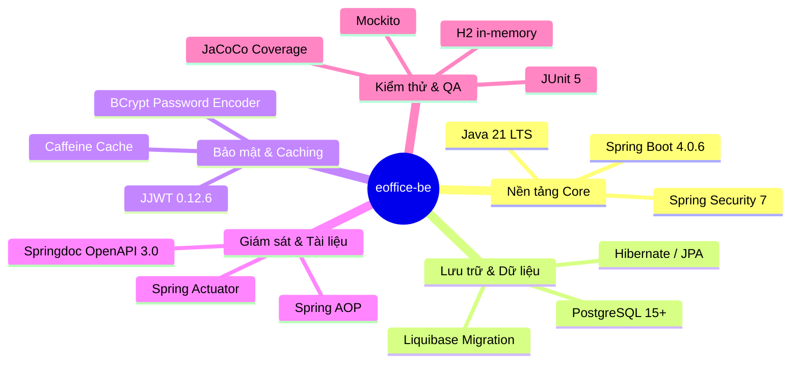

# 🏗️ 01. Tổng Quan Dự Án & Kiến Trúc Hệ Thống

Tài liệu này cung cấp bức tranh toàn cảnh về kiến trúc kỹ thuật, công nghệ và luồng xử lý của hệ thống **`eoffice-be`**.

---

## 1. Giới Thiệu Dự Án

**`eoffice-be`** là nền tảng Backend API phục vụ hệ thống Văn phòng điện tử (e-Office) cho Trường Đại học Điện Lực (EPU). Hệ thống được thiết kế hướng tới khả năng mở rộng cao, bảo mật chặt chẽ và phục vụ các nghiệp vụ:
- Quản lý định danh và hồ sơ người dùng.
- Quản lý cơ cấu cây tổ chức trường học / phòng ban / khoa / viện.
- Phân quyền theo ma trận: Vai trò toàn cục (Role) + Chức vụ tại đơn vị (Position Scope) + Ủy quyền (Delegation).
- Nhật ký truy cập (User Audit Log) và lịch sử biến động dữ liệu (Entity Change History).
- Quản lý và xử lý văn bản, tài liệu số hóa (sẵn sàng tích hợp Spring AI Document Reader).

---

## 2. Công Nghệ Sử Dụng (Tech Stack)



---

## 3. Kiến Trúc Phân Tầng (Layered Architecture)

Hệ thống tuân thủ nghiêm ngặt nguyên tắc phân tầng và tính đơn nhiệm (**Single Responsibility Principle**):

```mermaid
graph TD
    Client[Web Browser / Mobile App / Postman] -->|HTTP Request| Gateway[Spring Security Filter Chain]
    
    subgraph "1. Security & Authentication Layer"
        Gateway --> RateLimit[LoginRateLimiter - Caffeine]
        Gateway --> JwtFilter[JwtAuthenticationFilter]
        JwtFilter --> RbacEval[RbacPermissionEvaluator]
    end

    subgraph "2. Controller Layer (Giao tiếp)"
        JwtFilter --> AuthController[AuthController]
        JwtFilter --> AuditController[AuditLogControllers]
        JwtFilter --> OtherControllers[Business Controllers...]
    end

    subgraph "3. Aspect / Cross-Cutting Layer (AOP)"
        AuthController -.->|@Auditable| AuditAspect[ControllerAuditAspect]
        AuditAspect -->|Async Event| AsyncAudit[AuditLogAsyncService]
    end

    subgraph "4. Service Layer (Nghiệp vụ)"
        AuthController --> AuthService[AuthService]
        AuthController --> JwtService[JwtService]
        AuthController --> RefreshTokenService[RefreshTokenService]
        RbacEval --> PermResolver[PermissionResolver]
    end

    subgraph "5. Persistence Layer (Dữ liệu)"
        AuthService --> UserLoginRepo[UserLoginRepository]
        AuthService --> UserInfoRepo[UserInfoRepository]
        RefreshTokenService --> RefreshTokenRepo[RefreshTokenRepository]
        PermResolver --> OrgNodeClosureRepo[OrgNodeClosureRepository]
        PermResolver --> PositionAssignmentRepo[PositionAssignmentRepository]
    end

    subgraph "6. Database Layer"
        UserLoginRepo --> Postgres[(PostgreSQL Database)]
        UserInfoRepo --> Postgres
        RefreshTokenRepo --> Postgres
        AsyncAudit --> Postgres
    end
```

---

## 4. Chi Tiết Các Tầng Chức Năng

### 4.1 Tầng Controller (`vn.edu.epu.eoffice_be.controller`)
- **Nhiệm vụ:** Tiếp nhận HTTP Request, validate dữ liệu đầu vào thông qua Jakarta Validation (`@Valid`, `@NotNull`, `@NotBlank`), gọi tầng Service và đóng gói kết quả trả về dưới dạng chuẩn `BaseResponse<T>`.
- **Nguyên tắc:** Controller **không chứa logic nghiệp vụ phức tạp**, không gọi trực tiếp Repository.

### 4.2 Tầng Service (`vn.edu.epu.eoffice_be.service`)
- **Nhiệm vụ:** Chứa toàn bộ nghiệp vụ (Business Logic), quản lý Transaction (`@Transactional`), ném ra các ngoại lệ nghiệp vụ (`BusinessException`) với mã lỗi định nghĩa trước (`ErrorCode`).
- **Nguyên tắc:** Mỗi Service đảm nhiệm một phạm vi nghiệp vụ riêng biệt.

### 4.3 Tầng Repository (`vn.edu.epu.eoffice_be.repository`)
- **Nhiệm vụ:** Tương tác với PostgreSQL qua Spring Data JPA. Định nghĩa các câu lệnh truy vấn tùy biến qua JPQL hoặc Native Query.
- **Nguyên tắc:** Mọi truy vấn đọc/ghi trên các thực thể kế thừa `BaseEntity` đều phải luôn kiểm tra cờ xóa mềm `delete_flg = false`.

### 4.4 Tầng AOP & Audit (`vn.edu.epu.eoffice_be.audit`)
- **Nhiệm vụ:** Tự động bắt vết hành động của người dùng (`@Auditable`) và biến động dữ liệu (`@TrackChange`) mà không làm rối mã nguồn nghiệp vụ.
- **Nguyên tắc:** Ghi nhật ký thực hiện bất đồng bộ (`@Async`) trong transaction độc lập để không ảnh hưởng đến hiệu năng của API chính.

---

## 5. Các Mẫu Thiết Kế Áp Dụng (Design Patterns)

1. **DTO Pattern (Data Transfer Object):** Tách bạch giữa Entity trong DB và dữ liệu trao đổi qua API (Request/Response DTO), ngăn lộ lọt các trường nhạy cảm như `password_hash`.
2. **Token Bucket Pattern:** Sử dụng trong `LoginRateLimiter` để giới hạn số lần thử đăng nhập/đăng ký từ cùng một địa chỉ IP.
3. **Closure Table Pattern:** Lưu trữ quan hệ tổ tiên - hậu duệ cho cây tổ chức phòng ban trong bảng `org_node_closures`, cho phép kiểm tra quan hệ phân cấp chỉ bằng 1 câu lệnh `JOIN`.
4. **Token Rotation Pattern:** Tự động hủy Refresh Token cũ và sinh cặp token mới mỗi khi refresh, chống lại rủi ro bị đánh cắp token.

---

👉 **Đọc tiếp:** [02. Cơ Sở Dữ Liệu & Thực Thể JPA](./02_co-so-du-lieu-va-thuc-the.md)
