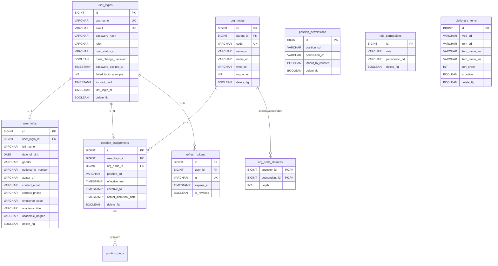

# 🗄️ 02. Cơ Sở Dữ Liệu & Thực Thể (JPA Entities)

Tài liệu này mô tả chi tiết lược đồ quan hệ cơ sở dữ liệu (ERD), danh sách các bảng và các thực thể JPA trong **`eoffice-be`**.

---

## 1. Sơ Đồ Thực Thể Quan Hệ (ERD)



---

## 2. Các Thực Thể Cơ Sở & Quy Ước Chung

### 2.1 Lớp Cơ Sở `BaseEntity`
Tất cả các thực thể nghiệp vụ kế thừa từ `BaseEntity` để tự động ghi nhận thông tin kiểm toán thông qua Spring Data JPA Auditing:
- `created_by` (VARCHAR): Tên người tạo bản ghi.
- `created_date` (TIMESTAMP WITH TIME ZONE): Thời điểm tạo bản ghi.
- `last_modified_by` (VARCHAR): Tên người sửa đổi cuối cùng.
- `last_modified_date` (TIMESTAMP WITH TIME ZONE): Thời điểm sửa đổi cuối cùng.

### 2.2 Chiến Lược Sinh Khóa Chính (Sequence Generator)
Dự án sử dụng sequence chung **`hibernate_sequence`** (bước nhảy `allocationSize = 50`) để tối ưu hóa hiệu năng chèn dữ liệu theo khối (Batch Inserts):
```java
@Id
@GeneratedValue(strategy = GenerationType.SEQUENCE, generator = "eoffice_seq")
@SequenceGenerator(name = "eoffice_seq", sequenceName = "hibernate_sequence", allocationSize = 50)
Long id;
```

### 2.3 Cơ Chế Xóa Mềm (Soft Delete)
Các bảng nghiệp vụ đều có cột `delete_flg` (boolean). Khi thực hiện thao tác xóa, dữ liệu không bị xóa vĩnh viễn khỏi database mà chỉ được gán `delete_flg = true`. Mọi câu truy vấn Repository mặc định luôn có điều kiện `AND delete_flg = false`.

---

## 3. Chi Tiết Nhóm Bảng Nghiệp Vụ

### 3.1 Phân Hệ Người Dùng (Users & Profiles)
- **`user_logins`**: Quản lý thông tin đăng nhập tối thiểu (username, email, mật khẩu băm, trạng thái, khóa tài khoản). Tách rời khỏi hồ sơ để đảm bảo hiệu năng cao khi xác thực.
- **`user_infos`**: Chứa toàn bộ thông tin lý lịch cá nhân chi tiết (họ tên, CCCD, chức danh khoa học, ngạch viên chức...). Liên kết `1-1` với `user_logins`.

### 3.2 Phân Hệ Cây Tổ Chức (Org Tree & Closure Table)
- **`org_nodes`**: Cấu trúc hình cây đại diện cho Ban giám hiệu, các Phòng, Khoa, Trung tâm, Bộ môn. Tự tham chiếu `parent_id`.
- **`org_node_closures`**: Bảng quan hệ đường đi tổ tiên - hậu duệ (Ancestor - Descendant) kèm độ sâu (`depth`).
  - *Ưu điểm:* Cho phép lấy toàn bộ danh sách đơn vị cấp dưới của một Khoa/Phòng chỉ với 1 câu lệnh `SELECT ... WHERE ancestor_id = :nodeId` với tốc độ cực nhanh.

### 3.3 Phân Hệ Phân Quyền (RBAC Matrix)
- **`position_assignments`**: Gán người dùng vào vị trí/chức vụ cụ thể tại một `org_node` (có hiệu lực từ ngày đến ngày).
- **`position_permissions`**: Gán quyền nghiệp vụ (`permission_cd`) cho từng chức danh (`position_cd`). Nếu `inherit_to_children = true`, người nắm giữ chức danh này tại node cha sẽ có quyền quản lý xuống các node con.
- **`role_permissions`**: Gán quyền cấp hệ thống cho các vai trò toàn cục (`USER`, `ADMIN`, `SYSTEM_ADMIN`).
- **`position_degs`**: Lưu thông tin ủy quyền tạm thời giữa các vị trí.

### 3.4 Phân Hệ Danh Mục & Token
- **`dictionary_items`**: Bảng từ điển dữ liệu hệ thống (danh sách chức vụ `POSITION_CD`, loại cơ quan `ORG_NODE_TYPE_CD`, trạng thái hợp đồng...).
- **`refresh_tokens`**: Quản lý định danh `jti` (UUID) của refresh token, thời gian hết hạn và trạng thái thu hồi (`is_revoked`).

### 3.5 Phân Hệ Nhật Ký Kiểm Toán (Audit & Logs)
- **`user_audit_logs`**: Ghi nhận vết truy cập API (Client IP, User Agent, URI, Method, Tham số, Thời gian thực thi).
- **`change_history_logs`**: Ghi nhận biến động dữ liệu từng bảng (`table_name`, `object_id`, `action`), lưu trạng thái `before_data`, `after_data` và `changed_fields` dưới dạng **PostgreSQL JSONB**.

---

👉 **Đọc tiếp:** [03. Xác Thực & Bảo Mật JWT](./03_xac-thuc-va-bao-mat-jwt.md)
