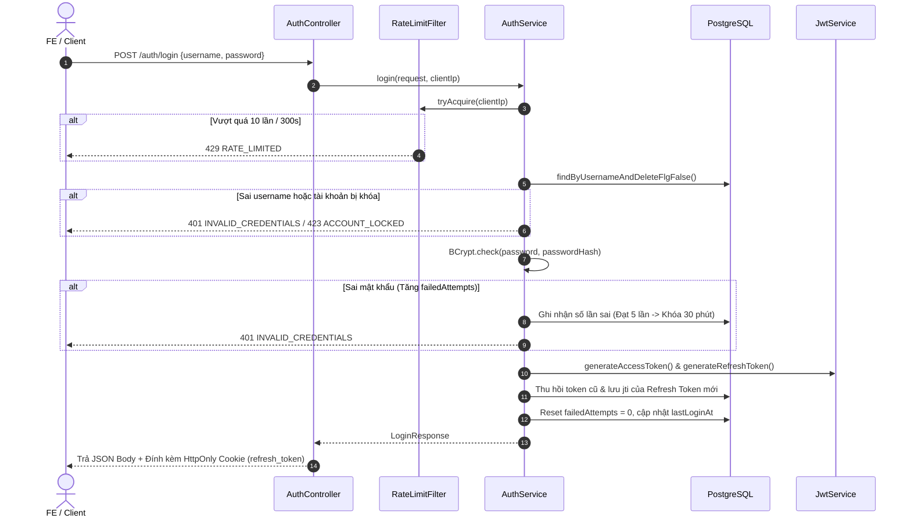
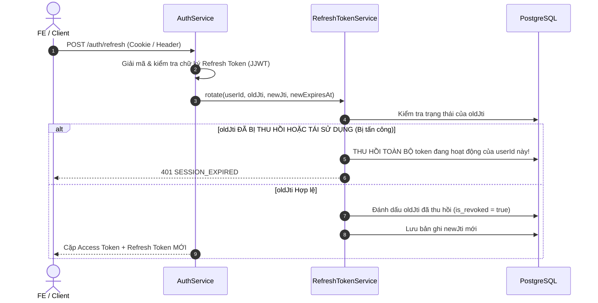

# 🔐 03. Xác Thực & Bảo Mật JWT (Authentication & Security)

Tài liệu này giải thích chi tiết cơ chế xác thực JWT Stateless, luồng xoay vòng Refresh Token (Token Rotation), bảo vệ
chống tấn công Brute-force và bảo mật Cookie trong **`eoffice-be`**.

---

## 1. Tổng Quan Cơ Chế Xác Thực

Hệ thống sử dụng mô hình **Dual Token** (cặp 2 token) dựa trên tiêu chuẩn JWT HS256:

- **Access Token (Ngắn hạn - 15 phút):** Mang theo thông tin người dùng cơ bản (`sub`, `username`, `role`), dùng để truy
  cập các API yêu cầu xác thực (`Authorization: Bearer <accessToken>`). Token này là stateless, không truy vấn DB khi
  kiểm tra hợp lệ.
- **Refresh Token (Dài hạn - 30 ngày):** Chứa định danh duy nhất `jti` (UUID) được lưu vết trong bảng `refresh_tokens`.
  Được dùng để xin cấp Access Token mới mà không bắt người dùng phải đăng nhập lại.

---

## 2. Luồng Xử Lý Chi Tiết (Authentication Flows)

### 2.1 Luồng Đăng Nhập (`POST /auth/login`)



---

### 2.2 Luồng Làm Mới Token & Xoay Vòng (Refresh Token Rotation)

Để ngăn chặn triệt để nguy cơ kẻ tấn công đánh cắp Refresh Token, hệ thống áp dụng kỹ thuật **Token Rotation** và **Phát
hiện tái sử dụng token (Reuse Detection)**:



---

### 2.3 Luồng Đăng Ký Tài Khoản (`POST /auth/register`)

1. Kiểm tra Rate Limit theo IP của client.
2. Kiểm tra trùng lặp `username` và `email` (Bảo vệ 2 lớp: Code check + DB Unique Constraint).
3. Băm mật khẩu bằng thuật toán **BCrypt** (`@Size(min=8, max=72)`).
4. Tạo tài khoản với vai trò mặc định `Role.USER` và trạng thái `ACTIVE`.
5. **Auto-login:** Tự động sinh ngay cặp Access/Refresh Token và trả về cho client mà không bắt đăng nhập lại.

---

### 2.4 Luồng Lấy Thông Tin Cá Nhân (`GET /auth/me`)

- Yêu cầu Header: `Authorization: Bearer <accessToken>`.
- Hệ thống trích xuất `userId` từ token, truy vấn dữ liệu từ cả 2 bảng `user_logins` và `user_infos`.
- Trả về cờ `profileCompleted`:
    - `profileCompleted = true`: Người dùng đã hoàn thiện thông tin hồ sơ lý lịch.
    - `profileCompleted = false`: Người dùng mới đăng ký, Frontend có thể dựa vào cờ này để bật popup nhắc hoàn thiện hồ
      sơ.

---

## 3. Cấu Trúc Payload Của JSON Web Token

```json
{
  "sub": "1001",
  "username": "nguyenvana",
  "role": "USER",
  "token_type": "access",
  "jti": "d7a4b89e-2f1c-4e8b-90a1-6d7c8e9f0a1b",
  "iss": "eoffice-be",
  "iat": 1755940000,
  "exp": 1755940900
}
```

- `token_type`: Phân biệt rõ `access` và `refresh` (ngăn việc dùng Access Token để gọi endpoint Refresh hoặc ngược lại).
- `jti`: Mã định danh ngẫu nhiên (UUID) duy nhất cho mỗi token.

---

## 4. Các Tính Năng Bảo Mật Nâng Cao

| Tính năng                   | Cơ chế thực hiện                     | Mục đích bảo vệ                                                   |
|:----------------------------|:-------------------------------------|:------------------------------------------------------------------|
| **Chống Brute-force**       | `RateLimitFilter` (Caffeine cache)   | Giới hạn tối đa 10 request/300s trên mỗi IP                       |
| **Khóa tài khoản tự động**  | `failed_login_attempts >= 5`         | Khóa tài khoản tạm thời 30 phút sau 5 lần sai mật khẩu            |
| **Bảo vệ Cookie**           | `HttpOnly; SameSite=Strict; Secure`  | Chống tấn công XSS đọc trộm cookie và CSRF                        |
| **Origin Whitelist**        | `AuthHttpUtils.assertAllowedOrigin`  | Chỉ cho phép các domain Frontend được cấu hình gọi refresh/logout |
| **Fail-Fast Configuration** | `@PostConstruct` validate JWT secret | Ứng dụng từ chối khởi động nếu khóa bí mật không đủ 256 bits      |

---

👉 **Đọc tiếp:** [04. Phân Quyền RBAC & Cây Tổ Chức](./04_phan-quyen-rbac-va-to-chuc.md)
