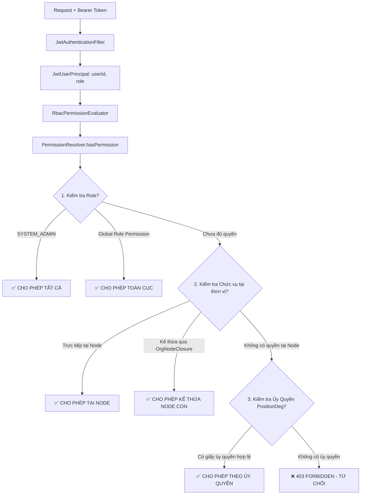

# 🏢 04. Phân Quyền RBAC & Cây Tổ Chức (Role & Org-Scoped Permissions)

Tài liệu này giải thích chi tiết kiến trúc phân quyền ma trận 3 lớp (RBAC Matrix) kết hợp với cây phân cấp cơ quan/phòng
ban trong **`eoffice-be`**.

---

## 1. Triết Lý Thiết Kế Phân Quyền

Trong môi trường các cơ quan hành chính và trường đại học lớn như EPU:

- **Một người dùng có thể đảm nhiệm nhiều chức vụ tại nhiều đơn vị khác nhau** (ví dụ: Vừa là Trưởng khoa CNTT, vừa là
  Thành viên Hội đồng trường).
- **Quyền hạn gắn liền với phạm vi đơn vị (Org Scope):** Trưởng khoa CNTT chỉ có quyền duyệt hồ sơ nội bộ Khoa CNTT và
  các Bộ môn trực thuộc, không có quyền duyệt hồ sơ của Khoa Điện.
- **Không nhúng quyền chi tiết vào JWT Token:** JWT Token chỉ mang `role` cơ bản. Quyền chi tiết luôn được phân giải
  động (**Runtime Resolution**) từ cơ sở dữ liệu để phản ánh tức thì khi có quyết định bổ nhiệm hoặc miễn nhiệm mà không
  cần người dùng đăng xuất.

---

## 2. Mô Hình Phân Quyền 3 Lớp



---

## 3. Chi Tiết 3 Lớp Quyền

### 3.1 Lớp 1: Vai Trò Cấp Hệ Thống (Global Roles)

Được quản lý trong enum [
`Role.java`](file:///d:/Visual%20studio%20code/eoffice-be/src/main/java/vn/edu/epu/eoffice_be/common/enums/Role.java)
và [
`RolePermissionCatalog.java`](file:///d:/Visual%20studio%20code/eoffice-be/src/main/java/vn/edu/epu/eoffice_be/security/RolePermissionCatalog.java):

- **`SYSTEM_ADMIN`**: Quản trị viên tối cao — tự động bypass qua mọi bước kiểm tra quyền ở tất cả các phòng ban.
- **`ADMIN`**: Quản trị viên hệ thống — sở hữu các quyền toàn cục khi `orgNodeId == null` (ví dụ: `org:manage`,
  `user:manage`, `audit:read`).
- **`USER`**: Người dùng bình thường — quyền hạn phụ thuộc hoàn toàn vào chức vụ được bổ nhiệm tại đơn vị.

### 3.2 Lớp 2: Quyền Theo Chức Vụ & Phạm Vi Đơn Vị (Position-Based Org Scope)

Một phân bổ vị trí (`PositionAssignment`) được coi là hợp lệ khi thỏa mãn:

1. `delete_flg = false`.
2. Thời gian hiện tại nằm trong khoảng `[effective_from, effective_to]`.
3. `actual_dismissal_date IS NULL` (chưa bị miễn nhiệm).

**Cơ chế kế thừa quyền (Permission Inheritance):**

- Trong bảng `position_permissions`, nếu `inherit_to_children = true`: Người nắm giữ chức vụ tại đơn vị cha (ví dụ:
  Trưởng khoa tại Khoa CNTT) sẽ tự động sở hữu quyền đó tại tất cả các đơn vị con (Bộ môn Phần mềm, Bộ môn Mạng...) nhờ
  vào bảng liên kết đường đi `org_node_closures`.

### 3.3 Lớp 3: Cơ Chế Ủy Quyền Tạm Thời (Delegation)

- Bảng `position_degs` cho phép một cán bộ ủy quyền xử lý các công việc cụ thể cho cán bộ khác trong một khoảng thời
  gian xác định (`start_date` đến `end_date`).
- Khi kiểm tra, nếu cán bộ có bản ghi ủy quyền hợp lệ tại `orgNodeId`, hệ thống sẽ cho phép thực hiện thao tác.

---

## 4. Cách Áp Dụng Phân Quyền Trong Code Controller

Nhờ cấu hình `RbacPermissionEvaluator`, bạn có thể kiểm soát quyền cực kỳ ngắn gọn và trực quan bằng annotation
`@PreAuthorize`:

### 4.1 Kiểm tra quyền theo đơn vị cụ thể:

```java

@RestController
@RequestMapping("/org-nodes/{orgNodeId}/documents")
public class DocumentController {

	// Yêu cầu người dùng phải có quyền 'document:approve' tại chính orgNodeId này hoặc cấp cha kế thừa
	@PostMapping("/approve")
	@PreAuthorize("hasPermission(#orgNodeId, 'document:approve')")
	public BaseResponse<Void> approveDocument(@PathVariable Long orgNodeId, @RequestBody ApproveRequest request) {
		// Xử lý phê duyệt văn bản
		return BaseResponse.success(null);
	}
}
```

### 4.2 Kiểm tra quyền toàn cục:

```java

@RestController
@RequestMapping("/users")
public class UserController {

	// Yêu cầu quyền user:manage (thường dành cho Admin)
	@PostMapping
	@PreAuthorize("hasPermission(null, 'user:manage')")
	public BaseResponse<Void> createUser(@RequestBody CreateUserRequest request) {
		return BaseResponse.success(null);
	}
}
```

---

👉 **Đọc tiếp:** [05. Hệ Thống Audit & Nhật Ký Biến Động](./05_he-thong-audit-va-lich-su.md)
