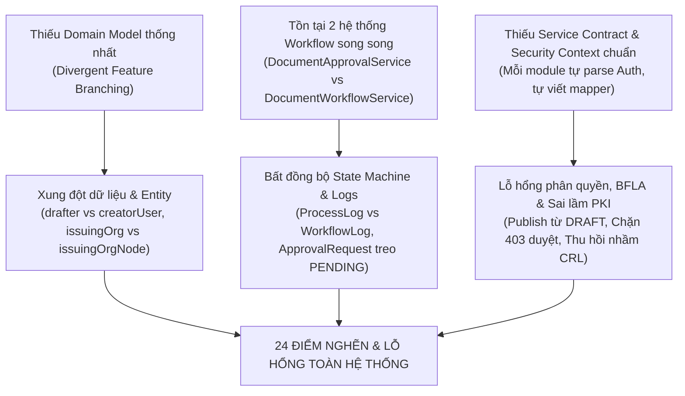

# BÁO CÁO TỔNG HỢP TOÀN DIỆN: ĐÁNH GIÁ KIẾN TRÚC & LỖ HỔNG HỆ THỐNG EOFFICE-BE

> **Mã hồ sơ**: AUDIT-EOFFICE-2026-FINAL  
> **Thời điểm cập nhật**: Tháng 10/2026  
> **Phạm vi kiểm thử**: Toàn bộ mã nguồn backend `eoffice-be` (Luồng văn bản, Phân quyền, Ký số PKI, Quản lý tệp, Database Schema, Liquibase & Environment Configurations).  
> **Tổng số vấn đề phát hiện**: **24 vấn đề & điểm nghẽn cốt lõi** (phân thành 4 nhóm nghiệp vụ).

---

## 1. NGUYÊN NHÂN GỐC RỄ (ROOT CAUSE ANALYSIS)

Toàn bộ 24 vấn đề đều là hệ quả trực tiếp từ **3 lỗ hổng kiến trúc cơ bản**:



1. **Phát triển phân mảnh theo nhánh tính năng (Feature-in-Isolation)**: Các module (`draft`, `approval`, `workflow`, `publish`, `book`, `profile`) được phát triển độc lập mà không xây dựng trước Core Domain Service và Service Contract dùng chung.
2. **Trùng lặp trách nhiệm nghiệp vụ (Dual Subsystems)**: Tồn tại 2 động cơ xử lý vòng đời tài liệu song song:
   * Hệ `DocumentApprovalService`: dùng `DocumentProcessLog`, `DocumentApprovalRequest`, DTO `DocumentResponse`.
   * Hệ `DocumentWorkflowService` / `WorkflowEngine`: dùng `DocumentWorkflowLog`, DTO `DocumentDetailResponse`.
   Hai hệ này hoàn toàn không giao tiếp với nhau dù cùng xử lý trên một bảng `documents`.
3. **Hiểu sai nghiệp vụ chuyên sâu (PKI & Security Misunderstanding)**: Nhầm lẫn giữa việc "Thu hồi một văn bản hành chính" với việc "Thu hồi Chứng thư số cá nhân (CRL)", dẫn đến việc hủy bỏ chứng thư của người ký khi hủy một văn bản.

---

## 2. BẢNG TỔNG HỢP 24 ĐIỂM NGHẼN & LỖ HỔNG THEO NHÓM

### Nhóm I: Lỗ hổng Bảo mật & Kiểm soát truy cập (Auth & Access Control)

| STT | Vấn đề | Tác động & Hậu quả | Dẫn chứng mã nguồn |
| :---: | :--- | :--- | :--- |
| **01** | **BFLA: Cho phép Ban hành trực tiếp từ trạng thái DRAFT** | Endpoint `POST /documents/{id}/publish` cho phép phát hành thẳng văn bản DRAFT, nhảy cóc qua toàn bộ thẩm định, ký nháy và phê duyệt của lãnh đạo. | [DocumentPublishService.java:L62-L69](file:///d:/Visual%20studio%20code/eoffice-be/src/main/java/vn/edu/epu/eoffice_be/service/DocumentPublishService.java#L62-L69) |
| **02** | **Lãnh đạo/Người duyệt bị 403 Forbidden khi xem hồ sơ văn bản** | URL mapping ưu tiên `DocumentController.getDraftDetail`, chặn mọi user không phải tác giả khi văn bản chưa `APPROVED`. Người duyệt không thể mở văn bản để duyệt. | [WebMvcMappingConfig.java:L63](file:///d:/Visual%20studio%20code/eoffice-be/src/main/java/vn/edu/epu/eoffice_be/config/WebMvcMappingConfig.java#L63), [DocumentController.java:L178-L186](file:///d:/Visual%20studio%20code/eoffice-be/src/main/java/vn/edu/epu/eoffice_be/controller/DocumentController.java#L178-L186) |
| **03** | **Người duyệt cấp sau & Văn thư bị 403 khi tải tệp đính kèm** | `DocumentAttachmentService` chỉ cấp quyền cho approver có `status = PENDING` trong `DocumentApprovalRequest`. Khi duyệt nhiều cấp, các cấp sau không được tạo bản ghi nên bị chặn tải file. | [DocumentAttachmentService.java:L195-L202](file:///d:/Visual%20studio%20code/eoffice-be/src/main/java/vn/edu/epu/eoffice_be/service/DocumentAttachmentService.java#L195-L202) |
| **04** | **Mất `orgId` trong JWT Access Token sau khi cập nhật hồ sơ cá nhân** | `ProfileService.completeProfile` gọi `generateAccessToken` thiếu tham số `orgId`, khiến token mới trả về có `orgId = null`. Người dùng lập tức bị 403 Forbidden trên mọi API văn bản ngay sau khi hoàn tất profile. | [ProfileService.java:L84](file:///d:/Visual%20studio%20code/eoffice-be/src/main/java/vn/edu/epu/eoffice_be/service/ProfileService.java#L84), [JwtService.java:L35-L42](file:///d:/Visual%20studio%20code/eoffice-be/src/main/java/vn/edu/epu/eoffice_be/service/JwtService.java#L35-L42) |
| **05** | **Bỏ qua kiểm tra xóa mềm (Soft-delete Bypass)** | `DocumentPublishService.verifyIntegrity` dùng `findById` thay vì `findByIdAndDeleteFlgFalse`, cho phép kiểm tra và tương tác với tài liệu đã bị xóa. | [DocumentPublishService.java:L179-L181](file:///d:/Visual%20studio%20code/eoffice-be/src/main/java/vn/edu/epu/eoffice_be/service/DocumentPublishService.java#L179-L181) |
| **06** | **Văn thư bị chặn phân phối/ban hành nếu thiếu Role ADMIN/LEADER** | Cấu hình `@PreAuthorize` và quyền hạn trong DB không map đúng quyền `DOCUMENT_DISTRIBUTE` và `DOCUMENT_PUBLISH` cho role CLERK (Văn thư). | [DocumentController.java](file:///d:/Visual%20studio%20code/eoffice-be/src/main/java/vn/edu/epu/eoffice_be/controller/DocumentController.java), [seed liquibase](file:///d:/Visual%20studio%20code/eoffice-be/src/main/resources/db/changelog/changes) |

---

### Nhóm II: Bẻ gãy Luồng nghiệp vụ & Trạng thái văn bản (State Machine & Logic)

| STT | Vấn đề | Tác động & Hậu quả | Dẫn chứng mã nguồn |
| :---: | :--- | :--- | :--- |
| **07** | **[THẢM HỌA PKI] Thu hồi văn bản làm vô hiệu hóa luôn Chứng thư số của Hiệu trưởng & Cán bộ ký** | Trong `revokeDocument`, hệ thống lấy toàn bộ SerialHex của các chữ ký trên PDF rồi gọi `revokeSerial`, tống vào `revoked.json` (CRL). Kết quả: Toàn bộ chứng thư số của Hiệu trưởng và người ký bị thu hồi toàn hệ thống, khiến MỌI VĂN BẢN KHÁC do họ từng ký bị coi là không hợp lệ! | [DocumentWorkflowServiceImpl.java:L1212-L1224](file:///d:/Visual%20studio%20code/eoffice-be/src/main/java/vn/edu/epu/eoffice_be/service/impl/DocumentWorkflowServiceImpl.java#L1212-L1224), [PdfSignatureVerifier.java:L497-L505, L629](file:///d:/Visual%20studio%20code/eoffice-be/src/main/java/vn/edu/epu/eoffice_be/security/pki/PdfSignatureVerifier.java#L497-L505) |
| **08** | **Xung đột trạng thái zombie giữa `ISSUED` và `PUBLISHED`** | Hai module dùng 2 enum khác nhau cho cùng trạng thái ban hành. `DocumentQueryService` chỉ lọc `PUBLISHED`, khiến văn bản mang trạng thái `ISSUED` biến mất khỏi danh sách tra cứu. | [DocumentQueryService.java:L104-L108](file:///d:/Visual%20studio%20code/eoffice-be/src/main/java/vn/edu/epu/eoffice_be/service/DocumentQueryService.java#L104-L108), [DocumentStatus.java](file:///d:/Visual%20studio%20code/eoffice-be/src/main/java/vn/edu/epu/eoffice_be/common/enums/DocumentStatus.java) |
| **09** | **Khóa cứng vị trí ký nháy: Lãnh đạo cấp cao hoặc người ủy quyền bị từ chối** | Hardcode vị trí chỉ cho phép `TP`, `TK` ký nháy. Hiệu trưởng, Phó Hiệu trưởng hoặc người được ủy quyền hợp pháp không thể thực hiện ký nháy hợp lệ. | [DocumentWorkflowServiceImpl.java:L790-L815](file:///d:/Visual%20studio%20code/eoffice-be/src/main/java/vn/edu/epu/eoffice_be/service/impl/DocumentWorkflowServiceImpl.java#L790-L815) |
| **10** | **Đóng băng tệp chính khiến người duyệt không thể chỉnh sửa / đóng dấu** | Khi file được đánh dấu `is_main_document = true`, hệ thống ngăn chặn việc ghi đè hoặc tạo phiên bản mới, làm tắc nghẽn luồng đóng dấu số PKI. | [DocumentAttachmentService.java](file:///d:/Visual%20studio%20code/eoffice-be/src/main/java/vn/edu/epu/eoffice_be/service/DocumentAttachmentService.java) |
| **11** | **Treo trạng thái `DocumentApprovalRequest` vĩnh viễn ở `PENDING`** | Khi `DocumentWorkflowServiceImpl` duyệt hoặc từ chối văn bản, bảng `document_approval_requests` không được cập nhật trạng thái, dẫn đến sai lệch dashboard phê duyệt. | [DocumentWorkflowServiceImpl.java:L120-L245](file:///d:/Visual%20studio%20code/eoffice-be/src/main/java/vn/edu/epu/eoffice_be/service/impl/DocumentWorkflowServiceImpl.java#L120-L245) |
| **12** | **Bỏ qua WorkflowEngine khi Gửi duyệt (`SUBMIT`) và Rút bản nháp (`WITHDRAW`)** | `DocumentApprovalService` tự đổi `document.setStatus(...)` trực tiếp, bỏ qua hoàn toàn bộ kiểm tra guards và ma trận chuyển trạng thái của `WorkflowEngine`. | [DocumentApprovalService.java:L278-L282, L367-L370](file:///d:/Visual%20studio%20code/eoffice-be/src/main/java/vn/edu/epu/eoffice_be/service/DocumentApprovalService.java#L278-L282) |

---

### Nhóm III: Mất mát Dữ liệu & Bất nhất Audit Trail (Data Integrity & Auditing)

| STT | Vấn đề | Tác động & Hậu quả | Dẫn chứng mã nguồn |
| :---: | :--- | :--- | :--- |
| **13** | **Mất dữ liệu phân phối văn bản (Silent Data Loss)** | `DocumentPublishService.extractTargetIds` dùng reflection tìm getter `getTargetIds`/`getOrgIds` sai tên trường (`recipientOrgIds`), làm mất sạch danh sách đơn vị nhận. | [DocumentPublishService.java:L139-L161](file:///d:/Visual%20studio%20code/eoffice-be/src/main/java/vn/edu/epu/eoffice_be/service/DocumentPublishService.java#L139-L161) |
| **14** | **Chia tách 2 hệ thống Audit Log: Bảng `document_process_logs` là write-only** | 4 service ghi vào `document_process_logs` nhưng không API nào đọc. API timeline lại đọc từ `document_workflow_logs`, làm mất toàn bộ vết gửi duyệt, rút duyệt, tải file, sửa version. | [DocumentProcessLogRepository.java](file:///d:/Visual%20studio%20code/eoffice-be/src/main/java/vn/edu/epu/eoffice_be/repository/DocumentProcessLogRepository.java), [DocumentWorkflowServiceImpl.java:L574-L598](file:///d:/Visual%20studio%20code/eoffice-be/src/main/java/vn/edu/epu/eoffice_be/service/impl/DocumentWorkflowServiceImpl.java#L574-L598) |
| **15** | **Tra cứu Sổ văn bản hiển thị lẫn lộn văn bản giữa các năm khác nhau** | Trong `DocumentRepository.findAssignedDocuments`, khi `d.documentBook IS NULL`, query lọc theo `typeCd` và `orgId` mà không kiểm tra `year`, làm sổ văn bản năm 2025 hiển thị lẫn văn bản của năm 2026. | [DocumentRepository.java:L234-L241](file:///d:/Visual%20studio%20code/eoffice-be/src/main/java/vn/edu/epu/eoffice_be/repository/DocumentRepository.java#L234-L241) |
| **16** | **Lệch số hiệu và bất đồng bộ giữa Sổ văn bản và Văn bản** | Cấp số văn bản dùng lock nhưng cơ chế cấp số và ghi nhận vào Document có nguy cơ bị lệch khi có exception xảy ra trong quá trình ký số. | [DocumentBookServiceImpl.java](file:///d:/Visual%20studio%20code/eoffice-be/src/main/java/vn/edu/epu/eoffice_be/service/impl/DocumentBookServiceImpl.java) |
| **17** | **Xung đột DTO phản hồi: `DocumentResponse` vs `DocumentDetailResponse`** | Cùng một đối tượng văn bản nhưng API trả về 2 DTO có cấu trúc trường và kiểu dữ liệu ngày tháng hoàn toàn khác nhau, gây khó khăn cho Frontend. | [DocumentResponse.java](file:///d:/Visual%20studio%20code/eoffice-be/src/main/java/vn/edu/epu/eoffice_be/dto/response/DocumentResponse.java) vs [DocumentDetailResponse.java](file:///d:/Visual%20studio%20code/eoffice-be/src/main/java/vn/edu/epu/eoffice_be/dto/response/DocumentDetailResponse.java) |
| **18** | **Nhân bản logic `resolvePositionName` tại 4 vị trí độc lập** | 4 switch-case hardcode chức danh giống nhau ở 4 service khác nhau. Khi thêm/đổi chức danh trong danh mục, các service hiển thị không đồng nhất. | [DocumentApprovalService.java:L390](file:///d:/Visual%20studio%20code/eoffice-be/src/main/java/vn/edu/epu/eoffice_be/service/DocumentApprovalService.java#L390), [DocumentWorkflowServiceImpl.java:L980](file:///d:/Visual%20studio%20code/eoffice-be/src/main/java/vn/edu/epu/eoffice_be/service/impl/DocumentWorkflowServiceImpl.java#L980) |

---

### Nhóm IV: Database Schema, Index, Timezone & Code Smells

| STT | Vấn đề | Tác động & Hậu quả | Dẫn chứng mã nguồn |
| :---: | :--- | :--- | :--- |
| **19** | **Unique Index chặn phân công nhiều Phó Hiệu trưởng/Phó Trưởng khoa** | Index `uq_position_assignments_active_non_gv` giới hạn mỗi đơn vị chỉ có tối đa 1 người cho mỗi chức vụ (trừ GV). Gán Phó Hiệu trưởng hoặc Phó Trưởng khoa thứ 2 gây lỗi 500 DB. | [2026-10-23_fix-position-assignment-limits-and-seed-clerk.yml:L33-L37](file:///d:/Visual%20studio%20code/eoffice-be/src/main/resources/db/changelog/changes/2026-10-23_fix-position-assignment-limits-and-seed-clerk.yml#L33-L37) |
| **20** | **Cột kép dư thừa trong Entity `Document` (`drafter_id` vs `creator_user_id`)** | Hai cột FK song song đại diện cho cùng một người tạo. JPQL query phân mảnh, phải dùng `@PrePersist` để sync ngầm trong Entity. | [Document.java:L76-L86, L182-L186](file:///d:/Visual%20studio%20code/eoffice-be/src/main/java/vn/edu/epu/eoffice_be/entity/Document.java#L76-L86) |
| **21** | **Cột kép dư thừa cơ quan ban hành (`issuing_org_id` vs `issuing_org_node_id`)** | Tương tự cột drafter, tồn tại 2 cột cùng trỏ về `OrgNode`, gây rủi ro dữ liệu không khớp khi câu truy vấn SQL chỉ chọn 1 trong 2 cột. | [Document.java:L72-L82, L177-L181](file:///d:/Visual%20studio%20code/eoffice-be/src/main/java/vn/edu/epu/eoffice_be/entity/Document.java#L72-L82) |
| **22** | **Lệch múi giờ giữa JVM UTC và Business Zone `Asia/Ho_Chi_Minh`** | `env.staging` ép JVM chạy `UTC`, nhưng code dùng trộn lẫn `ZoneId.systemDefault()`, `Document.getBusinessZone()` và hardcode `"Asia/Ho_Chi_Minh"`. Gây lệch ngày hiệu lực và lỗi cấp số sổ văn bản ban đêm / giao thừa. | [env.staging:L9-L12](file:///d:/Visual%20studio%20code/eoffice-be/env.staging#L9-L12), [Document.java:L189](file:///d:/Visual%20studio%20code/eoffice-be/src/main/java/vn/edu/epu/eoffice_be/entity/Document.java#L189), [DocumentWorkflowServiceImpl.java:L110](file:///d:/Visual%20studio%20code/eoffice-be/src/main/java/vn/edu/epu/eoffice_be/service/impl/DocumentWorkflowServiceImpl.java#L110) |
| **23** | **Lạm dụng Reflection và kiểm tra StackTrace ngay trong Controller** | `DocumentQueryController` chứa hơn 100 dòng code cache `ClassValue`, đọc `Thread.currentThread().getStackTrace()` để lấy `orgId` do thiếu typed principal contract. | [DocumentQueryController.java:L39-L109](file:///d:/Visual%20studio%20code/eoffice-be/src/main/java/vn/edu/epu/eoffice_be/controller/DocumentQueryController.java#L39-L109) |
| **24** | **Khóa mã hóa PKI yếu (Weak Key toàn số 0)** | Trong `env.staging`, `PKI_ENCRYPTION_KEY` bị cấu hình giá trị toàn số 0 `AAAAAAAAAAAAAAAAAAAAAAAAAAAAAAAAAAAAAAAAAAA=`, vi phạm nghiêm trọng tiêu chuẩn an toàn mật mã. | [env.staging:L19](file:///d:/Visual%20studio%20code/eoffice-be/env.staging#L19) |

---

## 3. MA TRẬN ẢNH HƯỞNG NGHIỆP VỤ (IMPACT MATRIX)

```
                     NGHIÊM TRỌNG CAO (CRITICAL)
                               │
               [01] BFLA Publish Draft │ [02] 403 Chặn Người Duyệt
               [07] Thảm Họa PKI CRL   │ [03] 403 Chặn Tải Phụ Lục
               [04] Mất orgId Profile  │ [16] Crash DB Phân Công PHT/PK
               [13] Mất Target Ban Hành│ [24] Khóa Mã Hóa PKI Yếu
                               │
───────────────────────────────┼───────────────────────────────
                               │
               [14] Chia cắt 2 AuditLog│ [08] Xung Đột ISSUED/PUBLISHED
               [20,21] Cột Kép Dư Thừa │ [11] Treo Request PENDING
               [23] Reflection Control.│ [17] Lệch DTO Response
               [15] Lẫn Năm Sổ Văn Bản │ [22] Lệch Múi Giờ UTC/VN
                               │
                     TRUNG BÌNH (MEDIUM / CODE HEALTH)
```

---

## 4. LỘ TRÌNH KHẮC PHỤC TOÀN DIỆN (REMEDIATION ROADMAP)

### Giai đoạn 1: Hotfix khẩn cấp (Sửa ngay trong 1-2 ngày)
1. **Khắc phục thảm họa thu hồi chứng thư số PKI ([07])**:
   * Xóa bỏ ngay logic gọi `pdfSignatureVerifier.revokeSerial(...)` trong `DocumentWorkflowServiceImpl.revokeDocument`.
   * Việc thu hồi văn bản chỉ cập nhật trạng thái `document.setStatus(DocumentStatus.REVOKED)` mà KHÔNG ĐƯỢC thêm chứng thư cá nhân của lãnh đạo vào CRL!
2. **Vá lỗ hổng BFLA ban hành văn bản ([01])**:
   * Loại bỏ ngay `DocumentStatus.DRAFT` khỏi `validStatuses` trong `DocumentPublishService.java`.
   * Bắt buộc kiểm tra `doc.getStatus() == DocumentStatus.APPROVED`.
3. **Sửa lỗi mất `orgId` sau khi hoàn tất hồ sơ ([04])**:
   * Trong `ProfileService.completeProfile`, tìm đơn vị chính (`active position assignment` hoặc `user.getOrgId()`) và truyền vào `jwtService.generateAccessToken(..., orgId)`.
4. **Sửa lỗi mất dữ liệu đơn vị nhận ban hành ([13])**:
   * Sửa `DocumentPublishService.extractTargetIds` để đọc trực tiếp `request.getRecipientOrgIds()`.
5. **Mở quyền xem văn bản và tải tệp đính kèm cho người duyệt ([02], [03])**:
   * Điều chỉnh `WebMvcMappingConfig` để các request `/documents/{id}` có thể đi đúng vào `DocumentWorkflowService.getDetail`.
   * Mở rộng kiểm tra quyền tải tệp trong `DocumentAttachmentService`: Cho phép người có quyền duyệt văn bản (`DOCUMENT_APPROVE`) hoặc thuộc đơn vị ban hành được phép truy cập.
6. **Sửa Database Index phân công chức vụ ([19])**:
   * Viết changeSet Liquibase mới: Thay đổi unique index `uq_position_assignments_active_non_gv` để cho phép các chức danh có tính chất cấp phó/chuyên viên (`PHT`, `PK`, `PP`, `CV`, `VT`) được phép có nhiều người trong một đơn vị, chỉ áp dụng đơn nhất đối với cấp trưởng (`HT`, `TK`, `TP`).

### Giai đoạn 2: Hợp nhất Luồng nghiệp vụ & Dữ liệu (1-2 tuần)
1. **Hợp nhất Workflow Engine ([11], [12], [14])**:
   * Tích hợp `submitForApproval` và `recallApproval` vào trong `WorkflowEngine` (sử dụng 2 action đã có sẵn: `WorkflowAction.SUBMIT` và `WorkflowAction.WITHDRAW`).
   * Thống nhất ghi lịch sử vào duy nhất bảng `document_workflow_logs`.
   * Đóng bảng hoặc đồng bộ trạng thái `DocumentApprovalRequest` khi các bước phê duyệt diễn ra.
2. **Xóa sổ trạng thái zombie `ISSUED` ([08])**:
   * Migrate toàn bộ dữ liệu mang `ISSUED` sang `PUBLISHED`.
   * Xóa enum `ISSUED` khỏi `DocumentStatus` và quy chuẩn 1 trạng thái duy nhất cho văn bản đã phát hành.
3. **Sửa logic tra cứu sổ văn bản ([15])**:
   * Thêm điều kiện lọc theo năm hiệu lực của văn bản (`YEAR(d.issueDate) = :year` hoặc `YEAR(d.effectiveDate) = :year`) trong `DocumentRepository.findAssignedDocuments`.
4. **Chuẩn hóa DTO phản hồi ([17], [18])**:
   * Hợp nhất `DocumentResponse` và `DocumentDetailResponse` thành một canonical response model.
   * Chuyển `resolvePositionName` vào `PositionService` hoặc `DictionaryService` tập trung.

### Giai đoạn 3: Tinh giản Kiến trúc & Refactor tầng Domain (2-4 tuần)
1. **Dọn dẹp cột trùng lặp trong Entity `Document` ([20], [21])**:
   * Viết migration script gom `drafter_id` và `creator_user_id` thành 1 cột duy nhất (`drafter_id` hoặc `creator_user_id`).
   * Gom `issuing_org_id` và `issuing_org_node_id` thành 1 cột duy nhất.
   * Xóa bỏ các hook `@PrePersist`/`@PreUpdate` gán chéo.
2. **Chuẩn hóa múi giờ toàn hệ thống ([22])**:
   * Thống nhất toàn bộ Backend và Database lưu trữ UTC (`Instant`), các tầng hiển thị convert sang múi giờ người dùng qua cấu hình Jackson tập trung.
3. **Loại bỏ Reflection & Chuẩn hóa Security Principal ([23])**:
   * Chuẩn hóa `CurrentUserPrincipal` implement interface `OrgAwarePrincipal` và `UserIdAwarePrincipal`.
   * Xóa toàn bộ logic cache reflection và kiểm tra StackTrace trong `DocumentQueryController`.
