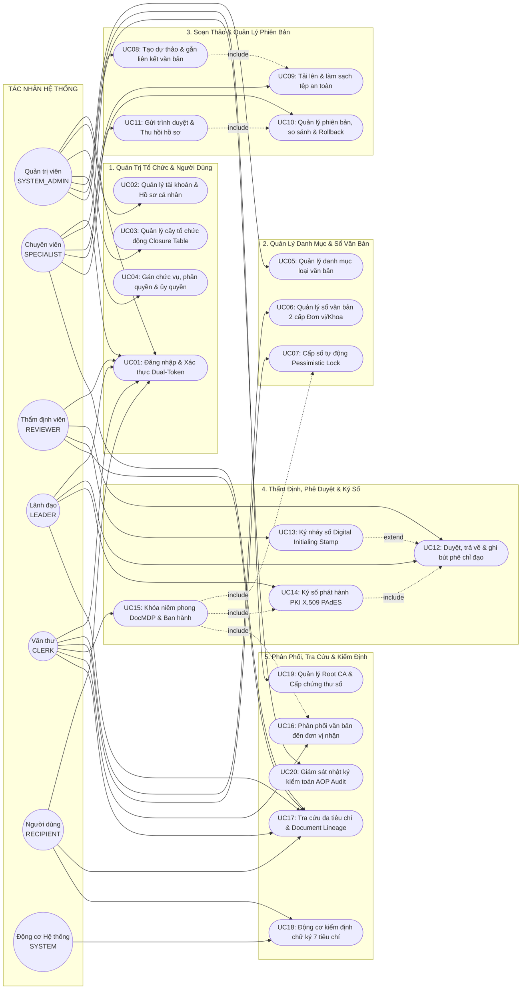
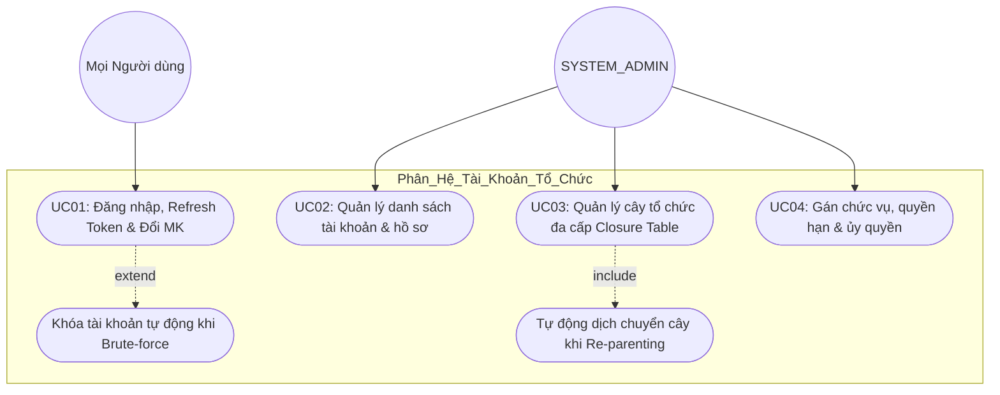
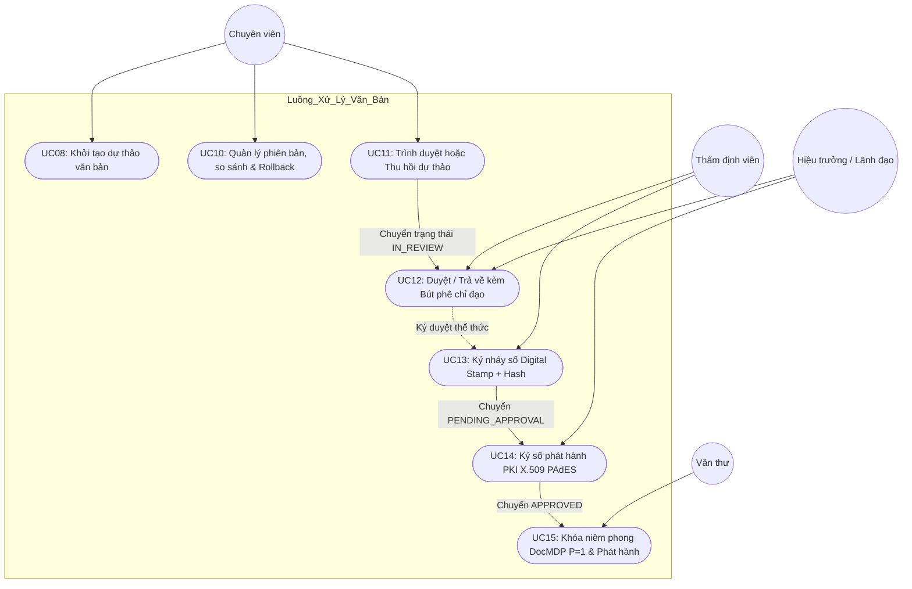
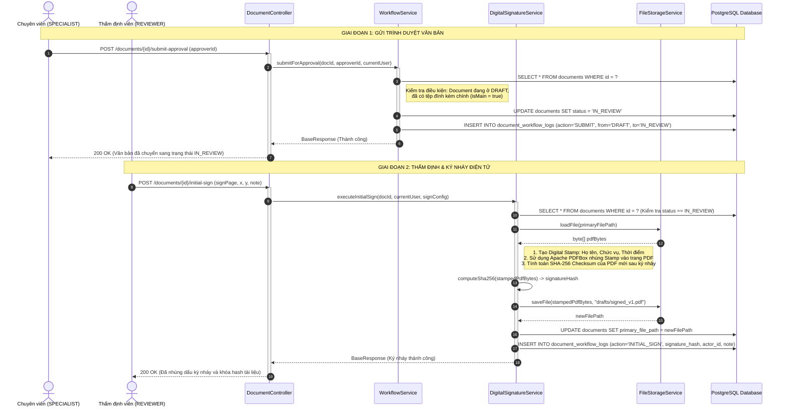
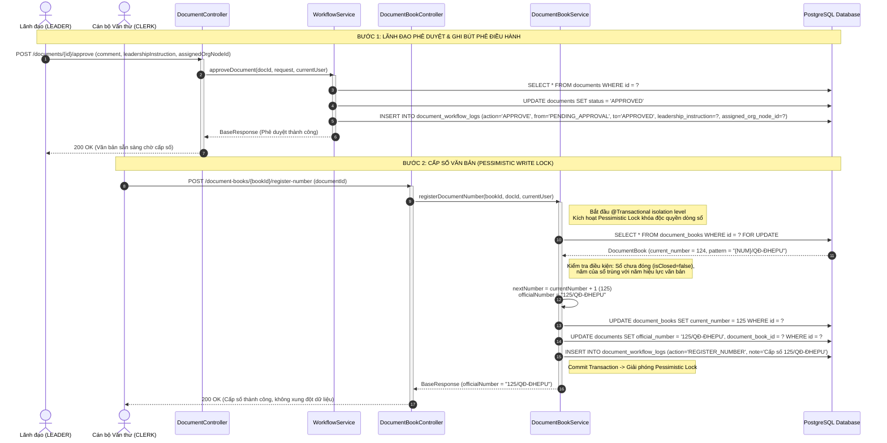
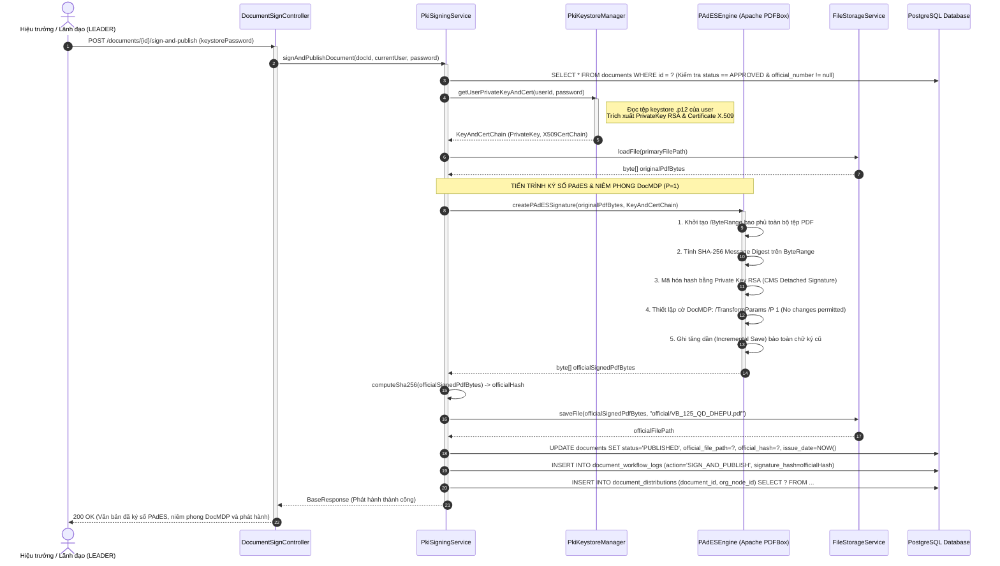
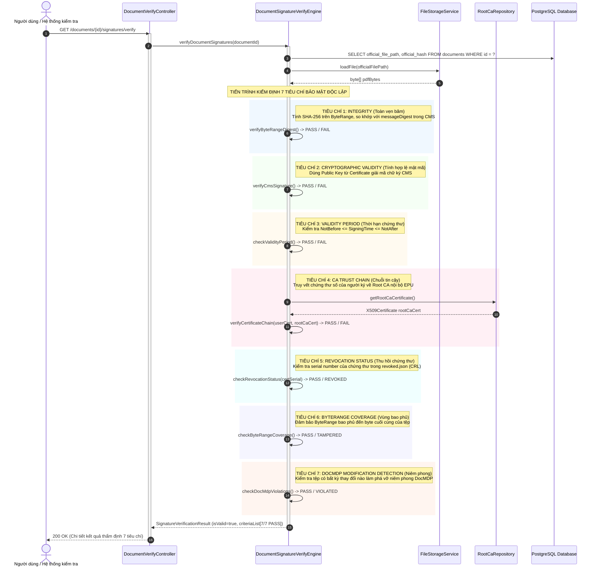

# 📐 BÁO CÁO THIẾT KẾ HỆ THỐNG: BIỂU ĐỒ USE CASE, BIỂU ĐỒ SEQUENCE VÀ BIỂU ĐỒ CLASS

---

> **TÊN ĐỀ TÀI:**  
> **"Nghiên cứu quy trình DevSecOps và các kỹ thuật lập trình an toàn ứng dụng trong phát triển thử nghiệm hệ thống thông tin hỗ trợ điều hành các hoạt động của một đơn vị trên văn bản điện tử"**  
> *(Phân hệ Backend RESTful API - `eoffice-be` | Trường Đại học Điện Lực - EPU)*

---

## 📑 MỤC LỤC TÀI LIỆU
1. [Mô Tả Tổng Quan Hệ Thống](#1-mô-tả-tổng-quan-hệ-thống)
2. [Biểu Đồ Use Case (Use Case Diagram) & Mô Tả Chi Tiết](#2-biểu-đồ-use-case-use-case-diagram--mô-tả-chi-tiết)
   - 2.1. Biểu đồ Use Case tổng thể toàn hệ thống
   - 2.2. Phân rã Use Case theo 5 phân hệ nghiệp vụ trọng tâm
   - 2.3. Bảng đặc tả chi tiết 20 Use Case cốt lõi
3. [Biểu Đồ Sequence (Sequence Diagram) & Mô Tả Các Luồng Nghiệp Vụ Cốt Lõi](#3-biểu-đồ-sequence-sequence-diagram--mô-tả-các-luồng-nghiệp-vụ-cốt-lõi)
   - 3.1. Luồng 1: Soạn thảo, Thẩm định và Ký nháy điện tử (Digital Initialing Stamp)
   - 3.2. Luồng 2: Lãnh đạo Phê duyệt (Bút phê) và Cấp số văn bản tự động (Pessimistic Lock)
   - 3.3. Luồng 3: Ký số phát hành PKI X.509 PAdES và Niêm phong tài liệu DocMDP
   - 3.4. Luồng 4: Động cơ kiểm định chữ ký số độc lập (Verify Engine 7 tiêu chí)
4. [Biểu Đồ Class (Class Diagram) & Mô Tả Thực Thể Dữ Liệu Miền](#4-biểu-đồ-class-class-diagram--mô-tả-thực-thể-dữ-liệu-miền)
   - 4.1. Sơ đồ Class tổng thể (Domain Class Diagram)
   - 4.2. Phân tích chi tiết các cụm thực thể (Entities & Relationships)
   - 4.3. Các mẫu thiết kế (Design Patterns) áp dụng trong cấu trúc lớp

---

# 1. MÔ TẢ TỔNG QUAN HỆ THỐNG

### 1.1. Bối cảnh và Mục tiêu Hệ thống
Hệ thống **`eoffice-be`** là nền tảng Backend API phục vụ quản lý văn phòng điện tử, điều hành tác nghiệp và số hóa văn bản hành chính theo quy chuẩn [Nghị định 30/2020/NĐ-CP](file:///d:/Visual%20studio%20code/eoffice-be/docs/bao-cao-chuyen-de-chuong-1-khao-sat-va-muc-tieu.md) cho Trường Đại học Điện Lực (EPU).

Hệ thống được xây dựng trên nền tảng **Java 21 LTS**, **Spring Boot 3.4.x**, **Spring Security 7**, cơ sở dữ liệu **PostgreSQL 16**, kết hợp với hạ tầng mật mã bất đối xứng **BouncyCastle** và xử lý tài liệu **Apache PDFBox 3.x**. 

Kiến trúc hệ thống được thiết kế giải quyết triệt để 4 trụ cột kỹ thuật trọng tâm của đề tài:
1. **An toàn tài liệu số & Ký số chuẩn Quốc gia**: Hiện thực hóa ký nháy điện tử và ký số phát hành chuẩn PKI X.509 PAdES (PDF Advanced Electronic Signatures), khóa niêm phong chống sửa đổi DocMDP ($P=1$) và tích hợp động cơ kiểm định chữ ký độc lập theo 7 tiêu chuẩn bảo mật khắt khe.
2. **Sổ văn bản 2 cấp & Cấp số chống xung đột**: Quản trị Sổ văn bản Cấp 1 (Đơn vị/Trường) và Cấp 2 (Phòng/Khoa nội bộ); cơ chế cấp số tự động sử dụng khóa ghi bi quan (**Pessimistic Write Lock**) ngăn chặn tuyệt đối hiện tượng trùng số văn bản khi có nhiều giao dịch đồng thời và tự động làm mới chu kỳ hàng năm.
3. **Mô hình tổ chức phân cấp động & Ma trận quyền RBAC 3 lớp**: Quản lý cây phòng ban đa tầng không giới hạn bằng bảng đóng (**Closure Table Pattern**), phân quyền theo Role toàn cục + Chức vụ tại đơn vị (Position Scope) + Cơ chế ủy quyền (Delegation).
4. **Vòng đời văn bản khép kín & Bút phê điều hành**: Hỗ trợ quản lý đa phiên bản (Document Versioning), so sánh phiên bản, khôi phục bản cũ, lưu trữ ý kiến bút phê chỉ đạo của Lãnh đạo và quản lý chuỗi văn bản liên kết cha - con (Document Lineage).

### 1.2. Các Tác Nhân Tham Gia Hệ Thống (Actors)
- **Người soạn thảo (`SPECIALIST` - Chuyên viên)**: Khởi tạo dự thảo, tải tệp tài liệu chính (DOCX/PDF) và phụ lục, quản lý các phiên bản, gửi trình duyệt, chủ động thu hồi hoặc sửa đổi dự thảo khi bị trả về.
- **Người thẩm định (`REVIEWER` - Trưởng phòng/Ban chức năng)**: Rà soát thể thức và nội dung chuyên môn, ký nháy số (Digital Initialing Stamp), yêu cầu chỉnh sửa hoặc chuyển tiếp hồ sơ lên Lãnh đạo.
- **Lãnh đạo đơn vị (`LEADER` - Hiệu trưởng, Phó Hiệu trưởng)**: Tiếp nhận hồ sơ trình duyệt, ghi nhận ý kiến bút phê chỉ đạo điều hành, phê duyệt nội dung hoặc thực hiện ký số phát hành chính thức.
- **Cán bộ văn thư (`CLERK`)**: Quản lý các cuốn sổ văn bản 2 cấp theo chu kỳ năm, tiếp nhận văn bản đã duyệt để kích hoạt cơ chế cấp số tự động chống trùng lặp và phát hành văn bản.
- **Đơn vị / Người nhận (`RECIPIENT`)**: Tiếp nhận văn bản phân phối, tra cứu hồ sơ theo phạm vi thẩm quyền, xem chuỗi liên kết văn bản cha - con và tải bản PDF chính thức.
- **Quản trị hệ thống (`SYSTEM_ADMIN`)**: Quản lý tài khoản, cấu trúc cây tổ chức, gán chức vụ, quản lý danh mục dùng chung, khởi tạo hạ tầng Root CA nội bộ và giám sát nhật ký kiểm toán (Audit Log).
- **Động cơ kiểm định (`VERIFY_ENGINE` - System Actor)**: Tác nhân hệ thống thực hiện giải mã, tính toán băm SHA-256, kiểm tra chứng thư, chuỗi tin cậy và niêm phong DocMDP của tài liệu PDF.

---

# 2. BIỂU ĐỒ USE CASE (USE CASE DIAGRAM) & MÔ TẢ CHI TIẾT

## 2.1. Biểu Đồ Use Case Tổng Thể Toàn Hệ Thống



---

## 2.2. Phân Rã Use Case Theo 5 Phân Hệ Nghiệp Vụ Trọng Tâm

### Phân hệ 1: Quản trị Tài khoản, Cơ cấu Tổ chức & Phân quyền (UC01 - UC04)


### Phân hệ 2: Quản lý Danh mục & Sổ Văn Bản 2 Cấp (UC05 - UC07)
```mermaid
flowchart TD
    ActorAdmin((SYSTEM_ADMIN))
    ActorClerk((Cán bộ Văn thư))

    subgraph Phân_Hệ_Sổ_Văn_Bản
        UC05([UC05: Quản lý danh mục loại văn bản & chức vụ])
        UC06([UC06: Khởi tạo & Đóng sổ văn bản 2 cấp])
        UC07([UC07: Cấp số văn bản tự động])
        
        SubUC_Pattern([Xác thực định dạng mẫu số {NUM}])
        SubUC_Lock([Pessimistic Write Lock chống Race Condition])
        SubUC_Reset([Reset số nhảy đầu năm mới 01/01])
    end

    ActorAdmin --> UC05
    ActorClerk --> UC06 & UC07
    UC06 -.->|include| SubUC_Pattern
    UC06 -.->|extend| SubUC_Reset
    UC07 -.->|include| SubUC_Lock
```

### Phân hệ 3 & 4: Soạn Thảo, Phê Duyệt & Ký Số PKI PAdES (UC08 - UC15)


---

## 2.3. Bảng Đặc Tả Chi Tiết 20 Use Case Cốt Lõi

| Mã UC | Tên Use Case | Tác nhân chính | Tiền điều kiện | Mô tả luồng nghiệp vụ & Ràng buộc bảo mật |
| :--- | :--- | :--- | :--- | :--- |
| **UC01** | Đăng nhập & Quản lý Token | Mọi người dùng | Tài khoản hoạt động | Xác thực username/password băm BCrypt. Trả về Access Token (15p) và Refresh Token HttpOnly Cookie. Giới hạn Rate Limiting chống Brute-force. |
| **UC02** | Quản lý người dùng & Hồ sơ | `SYSTEM_ADMIN` | Đã đăng nhập Admin | CRUD tài khoản `user_logins` và hồ sơ cá nhân `user_infos`. Khóa/Mở khóa tài khoản, reset mật khẩu tạm thời. |
| **UC03** | Quản lý cây tổ chức đa cấp | `SYSTEM_ADMIN` | Đã đăng nhập Admin | Thêm/sửa/xóa phòng ban, khoa, viện. Sử dụng `org_node_closures` tính toán lại độ sâu và phả hệ khi Re-parenting nút cha. |
| **UC04** | Gán chức danh & Phân quyền | `SYSTEM_ADMIN` | Đã đăng nhập Admin | Gán người dùng vào vị trí (`TP`, `HT`, `CV`...) tại một đơn vị cụ thể (`PositionAssignment`). Thiết lập ủy quyền tạm thời có thời hạn. |
| **UC05** | Quản lý danh mục dùng chung | `SYSTEM_ADMIN` | Đã đăng nhập Admin | Quản lý danh mục loại văn bản (`DOCUMENT_TYPE`), độ mật, độ khẩn, chức vụ (`DictionaryItem`). Cấm xóa cứng các mục đang được dùng. |
| **UC06** | Quản lý sổ văn bản 2 cấp | `CLERK`, Admin | Quyền văn thư | Tạo sổ văn bản Cấp 1 (Trường) hoặc Cấp 2 (Khoa/Phòng) theo năm. Kiểm tra mẫu số chứa `{NUM}`. Đóng sổ năm cũ (`is_closed = true`). |
| **UC07** | Cấp số văn bản tự động | `CLERK` | Văn bản `APPROVED` | Khóa dòng ghi sổ (`SELECT ... FOR UPDATE`), tăng số nhảy liên tục, gán số hiệu `{NUM}/MÃ_LOẠI-MÃ_ĐƠN_VỊ` vào văn bản. |
| **UC08** | Khởi tạo dự thảo văn bản | `SPECIALIST` | Quyên chuyên viên | Tạo dự thảo, nhập tiêu đề, trích yếu, chọn độ mật/khẩn, chọn văn bản cha liên kết (`parent_document_id`). Sinh mã dự thảo tự động. |
| **UC09** | Tải lên & Quản lý tệp đính kèm | `SPECIALIST` | Đang ở bản nháp | Tải file DOCX/PDF. Kiểm tra chống Path Traversal, đặt tên file UUID an toàn, phân loại tệp chính (`isMain = true`) và phụ lục. |
| **UC10** | Quản lý phiên bản văn bản | `SPECIALIST` | Đang ở bản nháp | Lưu snapshot đa phiên bản (`DocumentVersion`). Cho phép xem lịch sử, so sánh sai khác (Compare Diff) và khôi phục (Rollback). |
| **UC11** | Trình duyệt & Thu hồi hồ sơ | `SPECIALIST` | Có tệp chính | Lọc danh sách người duyệt đủ thẩm quyền (`Eligible Approvers`). Gửi duyệt chuyển `IN_REVIEW`. Cho phép thu hồi về `DRAFT` nếu chưa xử lý. |
| **UC12** | Duyệt & Ghi bút phê điều hành | `REVIEWER`, `LEADER` | Được phân công duyệt | Phê duyệt chuyển trạng thái, yêu cầu chỉnh sửa (`NEEDS_REVISION`) đóng băng file cũ, hoặc từ chối (`REJECTED`). Ghi ý kiến chỉ đạo bút phê. |
| **UC13** | Ký nháy điện tử | `REVIEWER` | Văn bản `IN_REVIEW` | Lấy file PDF từ Storage, tạo dấu ký nháy (Digital Stamp), nhúng vào vị trí quy định trang cuối, băm SHA-256 lưu vào `DocumentWorkflowLog`. |
| **UC14** | Ký số phát hành PKI PAdES | `LEADER` | Văn bản `APPROVED` | Sử dụng Private Key RSA của Lãnh đạo ký số lên toàn bộ ByteRange file PDF chính thức theo chuẩn CMS/PAdES. |
| **UC15** | Khóa niêm phong DocMDP & Ban hành | `CLERK`, `LEADER` | Đã ký số và cấp số | Đóng cờ chứng thực `DocMDP (P=1)` ngăn chặn mọi chỉnh sửa sau ký. Chuyển trạng thái sang `PUBLISHED`, lưu `official_hash`. |
| **UC16** | Phân phối văn bản | `CLERK`, Hệ thống | Văn bản `PUBLISHED` | Tự động tạo bản ghi phân phối (`DocumentDistribution`) tới cây các đơn vị trực thuộc được chỉ định nhận văn bản. |
| **UC17** | Tra cứu đa tiêu chí & Lineage | Mọi người dùng | Đã đăng nhập | Tìm kiếm văn bản theo trích yếu, số hiệu, ngày ban hành. Hiển thị cây liên kết chuỗi văn bản điều hành (Quyết định $\rightarrow$ Kế hoạch $\rightarrow$ Báo cáo). |
| **UC18** | Kiểm định tính toàn vẹn chữ ký | Toàn bộ người dùng | Có file hoặc Document ID | Động cơ kiểm tra độc lập 7 tiêu chí bảo mật: Hash, Chữ ký số CMS, Hạn chứng thư, Chuỗi CA Trust, Thu hồi CRL, ByteRange, DocMDP. |
| **UC19** | Quản lý hạ tầng Root CA | `SYSTEM_ADMIN` | Quyền Root Admin | Khởi tạo Root CA RSA 3072-bit, thời hạn 10 năm. Tự động sinh cặp khóa RSA 2048-bit và cấp chứng thư X.509 (`.p12`) cho người dùng khi ký. |
| **UC20** | Giám sát nhật ký kiểm toán | `SYSTEM_ADMIN` | Quyền Root Admin | Hệ thống AOP tự động bắt vết hành động người dùng (`@Auditable`), theo dõi biến động dữ liệu (`@TrackChange`), xuất báo cáo kiểm toán. |

---

# 3. BIỂU ĐỒ SEQUENCE (SEQUENCE DIAGRAM) & MÔ TẢ CÁC LUỒNG NGHIỆP VỤ CỐT LÕI

## 3.1. Luồng 1: Soạn Thảo, Thẩm Định và Ký Nháy Điện Tử (Digital Initialing Stamp)

Biểu đồ mô tả chi tiết quá trình Chuyên viên nộp hồ sơ dự thảo, Thẩm định viên kiểm tra và thực hiện thao tác ký nháy điện tử đóng dấu mã băm chống chỉnh sửa.



**Mô tả luồng hoạt động:**
1. Chuyên viên gửi yêu cầu trình duyệt kèm định danh người thẩm định. Hệ thống kiểm tra tính hợp lệ của hồ sơ (bắt buộc phải có tệp tài liệu chính), chuyển trạng thái từ `DRAFT` sang `IN_REVIEW` và khóa quyền sửa đổi của chuyên viên.
2. Thẩm định viên đọc văn bản, gọi API ký nháy. `DigitalSignatureService` tải tệp PDF nhị phân từ thư mục lưu trữ an toàn.
3. Hệ thống dựng hình ảnh con dấu ký nháy (Digital Stamp) bao gồm họ tên, chức danh, đơn vị và thời điểm ký. Nhúng dấu này trực tiếp vào trang văn bản thông qua Apache PDFBox.
4. Ngay sau khi nhúng dấu, hệ thống tính toán mã băm SHA-256 trên toàn bộ nội dung tệp mới, lưu đường dẫn tệp mới và lưu `signature_hash` vào bảng `document_workflow_logs`. Mã băm này là căn cứ chống việc chuyên viên sửa lén file sau khi lãnh đạo phòng đã ký nháy.

---

## 3.2. Luồng 2: Lãnh Đạo Phê Duyệt (Bút Phê) và Cấp Số Văn Bản (Pessimistic Lock)

Biểu đồ mô tả quy trình Lãnh đạo cho ý kiến chỉ đạo (bút phê), phê duyệt thông qua nội dung và Cán bộ văn thư thực hiện cấp số văn bản với cơ chế khóa ghi bi quan chống trùng số tuyệt đối.



**Mô tả luồng hoạt động:**
1. Lãnh đạo xem xét hồ sơ, phê duyệt chuyển trạng thái sang `APPROVED`. Ý kiến chỉ đạo bút phê (`leadershipInstruction`) và đơn vị chịu trách nhiệm thực thi (`assignedOrgNode`) được lưu vết vĩnh viễn vào `document_workflow_logs`.
2. Cán bộ văn thư thực hiện cấp số chính thức từ Sổ văn bản tương ứng. 
3. Để ngăn chặn xung đột khi có hàng chục cán bộ văn thư cùng ban hành văn bản tại một thời điểm, hệ thống thực thi truy vấn `SELECT ... FOR UPDATE`. Cơ sở dữ liệu PostgreSQL khóa cứng dòng ghi của cuốn sổ đó cho đến khi transaction hoàn tất.
4. Bộ đếm `current_number` được tăng thêm 1 an toàn và ghép vào mẫu số (`pattern`) để tạo ra số hiệu chính thức chuẩn (ví dụ: `125/QĐ-ĐHEPU`).

---

## 3.3. Luồng 3: Ký Số Phát Hành PKI X.509 PAdES và Niêm Phong Tài Liệu DocMDP

Biểu đồ mô tả quy trình Lãnh đạo ký số điện tử bằng khóa bí mật RSA, nhúng chứng thư X.509 theo chuẩn PAdES và đóng dấu niêm phong DocMDP ngăn chặn chỉnh sửa văn bản.



**Mô tả luồng hoạt động:**
1. Lãnh đạo thực hiện lệnh ký số và phát hành chính thức văn bản.
2. `PkiKeystoreManager` đọc kho khóa cá nhân PKCS#12 (`user_<id>.p12`) của Lãnh đạo, giải mã Private Key bằng mật khẩu an toàn và lấy chứng thư số X.509 do Root CA EPU chứng nhận.
3. `PAdESEngine` mở tệp PDF, áp dụng kỹ thuật lưu tăng dần (**Incremental Update**) để không phá hủy dấu ký nháy trước đó của Thẩm định viên.
4. Tính toán băm SHA-256 trên toàn bộ vùng dữ liệu tệp trừ phần chữ ký số, mã hóa tạo chữ ký CMS Detached.
5. Thiết lập từ điển chứng thực tài liệu **DocMDP với mức độ $P=1$ (`CERTIFIED_NO_CHANGES_ALLOWED`)**. Bất kỳ hành động thêm trang, xóa chữ hoặc chỉnh sửa tệp PDF này sau khi ký đều sẽ làm hỏng chữ ký ngay lập tức.
6. Lưu tệp PDF phát hành cuối cùng vào thư mục lưu trữ chính thức, lưu mã băm `official_hash` và cập nhật trạng thái văn bản sang `PUBLISHED`.

---

## 3.4. Luồng 4: Động Cơ Kiểm Định Chữ Ký Số Độc Lập (Verify Engine 7 Tiêu Chí)

Biểu đồ mô tả quy trình Động cơ kiểm tra toàn diện 7 tiêu chí bảo mật độc lập khi một người dùng hoặc hệ thống bên ngoài gửi yêu cầu xác minh tính hợp pháp của văn bản điện tử.



**Mô tả luồng hoạt động:**
Khi kiểm định chữ ký, hệ thống không chỉ kiểm tra đơn thuần tệp có bị sửa hay không mà thực hiện quét sâu 7 lớp bảo mật:
1. **`INTEGRITY`**: Băm lại dữ liệu PDF theo từng ByteRange và đối soát trực tiếp với `messageDigest` đóng gói trong cấu trúc CMS SignedAttributes.
2. **`CRYPTOGRAPHIC VALIDITY`**: Sử dụng khóa công khai trong chứng thư số để giải mã kiểm tra tính hợp lệ toán học của chữ ký.
3. **`VALIDITY PERIOD`**: Kiểm tra chứng thư số có nằm trong thời hạn có hiệu lực tại thời điểm ký văn bản hay không.
4. **`CA TRUST CHAIN`**: Xác thực đường dẫn tin cậy ngược về chứng thư số gốc Root CA của Trường Đại học Điện Lực.
5. **`REVOCATION STATUS`**: Đối chiếu danh sách chứng thư bị thu hồi (Certificate Revocation List - CRL) để phát hiện trường hợp khóa bị hủy bỏ do mất mát hoặc cán bộ chuyển công tác.
6. **`BYTERANGE COVERAGE`**: Kiểm tra vùng ký có kéo dài đến byte cuối cùng của tệp tin hay không, phát hiện hành vi chèn thêm mã độc hoặc dữ liệu rác vào đuôi tệp sau khi ký.
7. **`DOCMDP DETECTION`**: Phân tích cây đối tượng PDF để đảm bảo cấu trúc văn bản được giữ nguyên trạng đúng cam kết niêm phong $P=1$.

---

# 4. BIỂU ĐỒ CLASS (CLASS DIAGRAM) & MÔ TẢ THỰC THỂ DỮ LIỆU MIỀN

## 4.1. Sơ Đồ Class Tổng Thể (Domain Class Diagram)

Sơ đồ mô tả cấu trúc các thực thể cốt lõi, quan hệ kế thừa từ `BaseEntity` và mối liên kết dữ liệu giữa các phân hệ trong hệ thống:

```mermaid
classDiagram
    %% Lớp cơ sở dùng chung
    class BaseEntity {
        <<MappedSuperclass>>
        +String createdBy
        +Instant createdDate
        +String lastModifiedBy
        +Instant lastModifiedDate
    }

    %% Phân hệ Xác thực & Người dùng
    class UserLogin {
        +Long id
        +String username
        +String email
        +String passwordHash
        +String role
        +String userStatusCd
        +Boolean mustChangePassword
        +Instant passwordExpiredAt
        +Integer failedLoginAttempts
        +Instant lockoutUntil
        +Instant lastLoginAt
        +Boolean deleteFlg
    }

    class UserInfo {
        +Long id
        +String fullName
        +LocalDate dateOfBirth
        +String gender
        +String nationalIdNumber
        +String avatarUrl
        +String contactEmail
        +String contactPhone
        +String employeeCode
        +String academicTitle
        +String academicDegree
        +Boolean deleteFlg
    }

    class RefreshToken {
        +Long id
        +String rt
        +Instant expiresAt
        +Boolean isRevoked
    }

    %% Phân hệ Cây tổ chức & Phân quyền
    class OrgNode {
        +Long id
        +String code
        +String nameVn
        +String nameEn
        +String typeCd
        +Integer orgOrder
        +Boolean deleteFlg
    }

    class OrgNodeClosure {
        +Long ancestorId
        +Long descendantId
        +Integer depth
    }

    class PositionAssignment {
        +Long id
        +String positionCd
        +Instant effectiveFrom
        +Instant effectiveTo
        +Instant actualDismissalDate
        +Boolean deleteFlg
    }

    class PositionDeg {
        +Long id
        +Instant effectiveFrom
        +Instant effectiveTo
        +String reason
        +Boolean isActive
        +Boolean deleteFlg
    }

    %% Phân hệ Sổ văn bản & Danh mục
    class DocumentBook {
        +Long id
        +String bookCode
        +String bookName
        +Integer year
        +Integer bookLevel
        +Integer currentNumber
        +String numberPattern
        +Boolean isClosed
    }

    class DictionaryItem {
        +Long id
        +String typeCd
        +String itemCd
        +String itemNameVn
        +String itemNameEn
        +Integer sortOrder
        +Boolean isActive
        +Boolean deleteFlg
    }

    %% Phân hệ Quản lý Văn bản & Luồng
    class Document {
        +Long id
        +String draftCode
        +String title
        +String summary
        +String content
        +String documentTypeCd
        +Integer currentVersion
        +DocumentSecurityLevel securityLevel
        +DocumentUrgencyLevel urgencyLevel
        +DocumentStatus status
        +Instant submittedAt
        +String officialNumber
        +Instant issueDate
        +Instant effectiveDate
        +String officialHash
        +String primaryFilePath
        +String officialFilePath
        +Boolean deleteFlg
        +setStatus(status)
    }

    class DocumentAttachment {
        +Long id
        +String originalFileName
        +String storedFileName
        +String filePath
        +Long fileSizeBytes
        +String contentType
        +Boolean isMain
        +String fileHashSha256
        +Boolean deleteFlg
    }

    class DocumentVersion {
        +Long id
        +Integer versionNumber
        +String title
        +String summary
        +String content
        +String changeLog
        +String filePath
        +String fileHash
        +Boolean deleteFlg
    }

    class DocumentWorkflowLog {
        +Long id
        +WorkflowAction action
        +DocumentStatus fromStatus
        +DocumentStatus toStatus
        +String comment
        +String leadershipInstruction
        +String signatureHash
        +Boolean deleteFlg
    }

    class DocumentDistribution {
        +Long id
        +Instant sentAt
        +Boolean isRead
        +Instant readAt
        +Boolean deleteFlg
    }

    %% Phân hệ PKI Chữ ký số
    class PkiCaEntity {
        +Long id
        +String caType
        +String subjectDn
        +String certificatePem
        +String fingerprintSha256
        +Instant notBefore
        +Instant notAfter
        +Boolean isActive
    }

    class PkiUserKeystoreEntity {
        +Long id
        +String keystorePath
        +String keyAlias
        +String certificatePem
        +String fingerprintSha256
        +Instant certNotBefore
        +Instant certNotAfter
        +Boolean isRevoked
    }

    %% Quan hệ kế thừa BaseEntity
    BaseEntity <|-- UserLogin
    BaseEntity <|-- UserInfo
    BaseEntity <|-- OrgNode
    BaseEntity <|-- PositionAssignment
    BaseEntity <|-- PositionDeg
    BaseEntity <|-- DocumentBook
    BaseEntity <|-- DictionaryItem
    BaseEntity <|-- Document
    BaseEntity <|-- DocumentAttachment
    BaseEntity <|-- DocumentVersion
    BaseEntity <|-- DocumentWorkflowLog
    BaseEntity <|-- DocumentDistribution

    %% Quan hệ giữa các Class
    UserLogin "1" *-- "1" UserInfo : "hồ sơ chi tiết"
    UserLogin "1" o-- "0..*" RefreshToken : "quản lý phiên"
    UserLogin "1" o-- "0..*" PositionAssignment : "giữ chức vụ"
    OrgNode "1" o-- "0..*" PositionAssignment : "thuộc đơn vị"
    OrgNode "1" *-- "0..*" OrgNodeClosure : "cây phả hệ"
    PositionAssignment "1" o-- "0..*" PositionDeg : "ủy quyền cho"

    OrgNode "1" o-- "0..*" DocumentBook : "sở hữu sổ"
    DictionaryItem "1" o-- "0..*" DocumentBook : "loại văn bản của sổ"

    DocumentBook "0..1" o-- "0..*" Document : "cấp số cho"
    OrgNode "1" o-- "0..*" Document : "đơn vị ban hành"
    UserLogin "1" o-- "0..*" Document : "người soạn thảo / ký"
    Document "0..1" o-- "0..*" Document : "văn bản cha (Lineage)"

    Document "1" *-- "1..*" DocumentAttachment : "tệp đính kèm"
    Document "1" *-- "1..*" DocumentVersion : "lịch sử phiên bản"
    Document "1" *-- "0..*" DocumentWorkflowLog : "lịch sử luân chuyển"
    UserLogin "1" o-- "0..*" DocumentWorkflowLog : "người thực hiện"
    OrgNode "0..1" o-- "0..*" DocumentWorkflowLog : "đơn vị được giao xử lý"

    Document "1" o-- "0..*" DocumentDistribution : "phân phối tới"
    OrgNode "1" o-- "0..*" DocumentDistribution : "đơn vị nhận"

    UserLogin "1" *-- "0..1" PkiUserKeystoreEntity : "keystore cá nhân"
    PkiCaEntity "1" o-- "0..*" PkiUserKeystoreEntity : "ký cấp chứng thư"
```



---

## 4.2. Phân Tích Chi Tiết Các Cụm Thực Thể (Entities & Relationships)

### A. Cụm Quản Trị Danh Tính & Tổ Chức (Identity & Organization)
1. **`UserLogin` & `UserInfo` (Quan hệ 1 - 1)**:
   - Tách bạch thông tin đăng nhập tối thiểu (`user_logins`) và hồ sơ hành chính cá nhân (`user_infos`).
   - `UserLogin` lưu trữ `passwordHash` (chuẩn BCrypt), trạng thái tài khoản, các trường kiểm soát tấn công vét cạn: `failedLoginAttempts`, `lockoutUntil`, và cờ bắt buộc đổi mật khẩu `mustChangePassword`.
2. **`OrgNode` & `OrgNodeClosure` (Mô hình Closure Table)**:
   - `OrgNode` biểu diễn một nút trên cây tổ chức (Ban Giám hiệu, Phòng, Khoa, Bộ môn), liên kết cha - con qua `parent_id`.
   - `OrgNodeClosure` lưu toàn bộ các đường đi từ tổ tiên (`ancestor_id`) đến hậu duệ (`descendant_id`) kèm độ sâu `depth`. Cấu trúc này cho phép:
     - Kiểm tra một bộ môn có thuộc quyền quản lý của một khoa/phòng hay không bằng **1 câu lệnh SQL `JOIN` duy nhất**, loại bỏ hoàn toàn các truy vấn đệ quy làm suy giảm hiệu năng cơ sở dữ liệu.
     - Khi thực hiện di dời một phòng ban (Re-parenting), hệ thống chỉ cần cập nhật lại các bản ghi trong bảng `org_node_closures` mà không cần chạm vào dữ liệu văn bản đã phát hành.
3. **`PositionAssignment` & `PositionDeg` (Phân quyền & Ủy quyền)**:
   - `PositionAssignment` liên kết `UserLogin` với `OrgNode` thông qua mã chức danh `positionCd` (ví dụ: `HT` - Hiệu trưởng, `TP` - Trưởng phòng, `CV` - Chuyên viên).
   - `PositionDeg` ghi nhận cơ chế ủy quyền giữa các cán bộ, có thời hạn hiệu lực từ ngày đến ngày và lý do ủy quyền.

### B. Cụm Sổ Văn Bản & Danh Mục Dùng Chung (Registry & Dictionaries)
1. **`DocumentBook` (Sổ văn bản 2 cấp)**:
   - Quản lý sổ văn bản theo năm hành chính (`year`).
   - Trường `bookLevel` nhận giá trị `1` (Cấp Đơn vị/Trường) hoặc `2` (Cấp Phòng/Ban nội bộ).
   - Ràng buộc duy nhất `(year, org_node_id, document_type_id)` đảm bảo mỗi đơn vị chỉ có duy nhất 1 sổ cho một loại văn bản trong một năm.
   - Trường `numberPattern` định dạng mẫu số (ví dụ: `{NUM}/QĐ-ĐHEPU`). Bộ đếm `currentNumber` được cập nhật an toàn bằng khóa ghi bi quan `SELECT FOR UPDATE`.
2. **`DictionaryItem`**:
   - Quản lý tập trung các hằng số nghiệp vụ động: Loại văn bản (`DOCUMENT_TYPE_CD`), cấp độ khẩn, cấp độ mật.

### C. Cụm Quản Lý Văn Bản & Luồng Xử Lý (Documents & Workflow Lifecycle)
1. **`Document` (Thực thể trung tâm)**:
   - Lưu trữ toàn bộ siêu dữ liệu: tiêu đề `title`, trích yếu `summary`, nội dung `content`, mã dự thảo `draftCode`, số hiệu chính thức `officialNumber`.
   - Quản lý trạng thái thông qua `status` (`DRAFT`, `IN_REVIEW`, `PENDING_APPROVAL`, `APPROVED`, `PUBLISHED`, `NEEDS_REVISION`, `REJECTED`).
   - Quản lý chuỗi văn bản liên kết: Trường `parent_document_id` tự tham chiếu đến chính thực thể `Document`, cho phép hình thành cây phả hệ văn bản chỉ đạo (Quyết định $\rightarrow$ Kế hoạch $\rightarrow$ Báo cáo).
   - Lưu trữ tính toàn vẹn: `primaryFilePath` (tệp đang soạn thảo), `officialFilePath` (tệp PDF chính thức có chữ ký số), và `officialHash` (mã băm SHA-256 của tệp sau khi ban hành).
2. **`DocumentAttachment` & `DocumentVersion` (Quan hệ 1 - N)**:
   - `DocumentAttachment`: Quản lý các tệp đính kèm vật lý trên đĩa máy chủ. Tệp chính (`isMain = true`) là tệp được dùng để ký nháy và ký số. Tệp phụ lục (`isMain = false`) phục vụ tham khảo.
   - `DocumentVersion`: Snapshot lưu trữ toàn bộ trạng thái nội dung tại mỗi mốc phiên bản, phục vụ chức năng so sánh khác biệt và khôi phục (Rollback).
3. **`DocumentWorkflowLog` (Nhật ký luân chuyển & Bút phê)**:
   - Ghi vết mọi hành động chuyển trạng thái (`action`).
   - Lưu ý kiến chỉ đạo điều hành của Lãnh đạo (`leadershipInstruction`) và đơn vị được phân công chủ trì (`assignedOrgNode`).
   - Lưu `signatureHash` của tệp PDF tại thời điểm ký nháy hoặc ký phát hành, tạo thành bằng chứng điện tử không thể chối cãi.

### D. Cụm Hạ Tầng Mật Mã PKI (Public Key Infrastructure)
1. **`PkiCaEntity`**: Lưu thông tin Root CA nội bộ của Nhà trường, chuỗi chứng thư tự ký X.509, vân tay SHA-256 và thời hạn hiệu lực (10 năm).
2. **`PkiUserKeystoreEntity`**: Quản lý đường dẫn tới kho khóa PKCS#12 cá nhân (`user_<id>.p12`) của từng cán bộ, thời hạn chứng thư con (tối đa 3 năm) và trạng thái thu hồi khóa `isRevoked`.

---

## 4.3. Các Mẫu Thiết Kế (Design Patterns) Áp Dụng Trong Cấu Trúc Lớp

1. **Closure Table Pattern**: Áp dụng tại `OrgNodeClosure` để giải quyết bài toán cây phân cấp đơn vị đa tầng, giúp tra cứu quan hệ cha - con, tổ tiên - hậu duệ với độ phức tạp $O(1)$ thay vì đệ quy $O(N)$.
2. **State Pattern & Workflow State Machine**: Quản lý ma trận chuyển đổi trạng thái của `Document` qua các hàm nghiệp vụ nghiêm ngặt trong `WorkflowService`, ngăn chặn mọi hành vi chuyển trạng thái trái phép (ví dụ: không thể nhảy từ `DRAFT` trực tiếp lên `PUBLISHED`).
3. **Pessimistic Write Lock Pattern**: Áp dụng tại `DocumentBookRepository` thông qua `@Lock(LockModeType.PESSIMISTIC_WRITE)` để khóa độc quyền bản ghi sổ văn bản, triệt tiêu rủi ro tranh chấp dữ liệu (Race Condition) trong môi trường phân tán hoặc đa luồng.
4. **Data Transfer Object (DTO) Pattern**: Tách biệt hoàn toàn giữa các thực thể JPA trong cơ sở dữ liệu và dữ liệu trao đổi qua API (`DocumentCreateRequest`, `DocumentResponse`), ngăn chặn lộ lọt các trường nhạy cảm như băm mật khẩu hoặc đường dẫn tệp vật lý.
5. **Auditing & Aspect-Oriented Programming (AOP) Pattern**: Kế thừa `BaseEntity` kết hợp các Annotation tự tạo `@Auditable`, `@TrackChange` giúp hệ thống tự động ghi nhận người tạo, người sửa và lịch sử thay đổi mà không làm ô nhiễm mã nguồn nghiệp vụ.

---

## 5. KẾT LUẬN

Tài liệu này đã hoàn thiện đầy đủ và chi tiết 3 loại biểu đồ cốt lõi theo đúng tiêu chuẩn phân tích và thiết kế hệ thống thông tin:
- **Biểu đồ Use Case**: Làm rõ toàn bộ bức tranh chức năng, 5 phân hệ lớn, mối quan hệ tác nhân và chi tiết 20 Use Case nghiệp vụ gắn liền với Nghị định 30/2020/NĐ-CP.
- **Biểu đồ Sequence**: Trình bày rõ ràng 4 luồng nghiệp vụ xương sống của đề tài (Soạn thảo - Ký nháy số, Phê duyệt - Khóa ghi cấp số văn bản, Ký số phát hành PAdES niêm phong DocMDP, và Động cơ kiểm định 7 tiêu chí bảo mật).
- **Biểu đồ Class**: Chuẩn hóa toàn bộ cấu trúc dữ liệu miền, quan hệ giữa các thực thể JPA, các ràng buộc toàn vẹn cơ sở dữ liệu và các mẫu thiết kế hướng đối tượng được hiện thực hóa trong mã nguồn dự án.

Bộ tài liệu thiết kế này đóng vai trò cơ sở kỹ thuật trực tiếp để đưa vào **Chương 2** của cuốn báo cáo chuyên đề đồ án tốt nghiệp.
