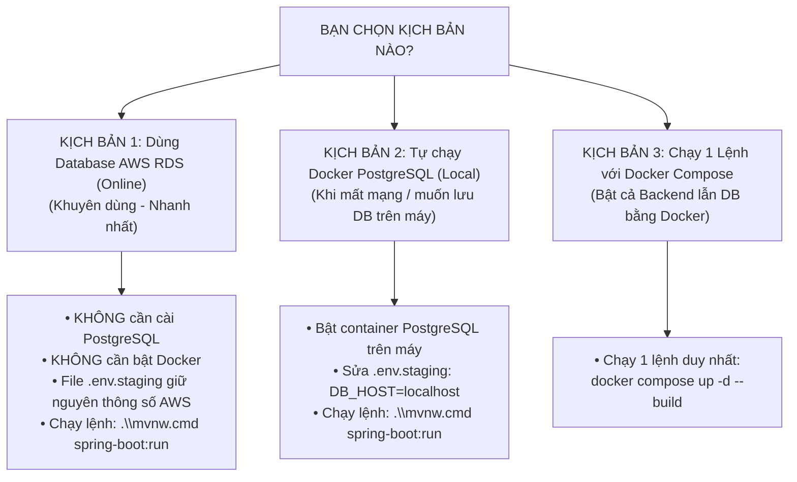

# ⚙️ 02. Cấu Hình & Khởi Chạy Ứng Dụng

Tài liệu này hướng dẫn cách cấu hình các biến môi trường và chạy ứng dụng **eoffice-be** ở môi trường local.

---

## 1. Quy Định Về Môi Trường (Environment Policy)

> [!WARNING]
> **Quy tắc bảo mật & chuẩn hóa cấu hình:**
> - Dự án chỉ sử dụng 2 profile chính: `staging` (dùng cho cả test local và staging server) và `prod`.
> - **Tuyệt đối không tạo hoặc commit file `application-local.yml`**.
> - **Tuyệt đối không commit file `.env.staging` chứa mật khẩu thật lên Git** (file này đã được thêm vào `.gitignore`).

---

## 2. Phân Biệt Các Kịch Bản Chạy Ứng Dụng & Database

> [!IMPORTANT]
> **Hãy chọn 1 trong các kịch bản dưới đây phù hợp nhất với máy của bạn:**



---

### Bảng So Sánh Các Kịch Bản:

| Tiêu chí                         | Kịch bản 1: AWS RDS (Online)  | Kịch bản 2: Docker DB Local                          | Kịch bản 3: Docker Compose (Cả 2)  |
|:---------------------------------|:------------------------------|:-----------------------------------------------------|:-----------------------------------|
| **Cần cài PostgreSQL trên máy?** | ❌ **Không**                   | ❌ **Không** (Dùng Docker image)                      | ❌ **Không** (Docker tự lo)         |
| **Cần bật Docker Desktop?**      | ❌ **Không**                   | ✅ **Có** (để chạy container DB)                      | ✅ **Có** (để chạy cả hệ thống)     |
| **Yêu cầu mạng Internet?**       | ✅ **Có** (để kết nối lên AWS) | ❌ **Không** (Chạy offline hoàn toàn)                 | ❌ **Không** (sau khi đã tải image) |
| **File `.env.staging`**          | Giữ nguyên Host AWS           | Sửa `DB_HOST=localhost`                              | Đã cấu hình sẵn trong compose      |
| **Lệnh thực thi**                | `.\mvnw.cmd spring-boot:run`  | 1. Bật Docker DB<br/>2. `.\mvnw.cmd spring-boot:run` | `docker compose up -d --build`     |

---

## 3. Hướng Dẫn Chi Tiết Từng Kịch Bản

---

### 🌟 KỊCH BẢN 1: Dùng Database AWS RDS Online (Khuyên dùng - Dễ nhất)

* **Khi nào nên dùng:** Bạn vừa clone dự án về, muốn chạy thử nghiệm ngay mà không muốn mất thời gian cài đặt PostgreSQL
  hay cấu hình Docker.
* **Cơ chế:** Database PostgreSQL đã được dựng sẵn và mở cổng trên AWS RDS (`us-east-1`). Backend trên máy bạn sẽ kết
  nối thẳng lên AWS qua Internet.

#### Các bước thực hiện:

1. **Chuẩn bị file [`.env.staging`](file:///d:/Visual%20studio%20code/eoffice-be/.env.staging) tại thư mục gốc:**  
   *(Copy từ file `.env.staging.example` hoặc lấy thông tin cấu hình từ quản trị viên dự án)*:
   ```properties
   SPRING_PROFILES_ACTIVE=staging
   DB_HOST=your-staging-host
   DB_PORT=5432
   DB_NAME=your-db-name
   DB_USERNAME=your-username
   DB_PASSWORD=your-password
   JWT_SECRET=your-jwt-secret-key-at-least-32-characters
   COOKIE_SECURE=false
   ```

2. **Khởi chạy Backend (Terminal / PowerShell):**
   ```powershell
   # Trên Windows
   .\mvnw.cmd spring-boot:run

   # Trên Linux / macOS
   ./mvnw spring-boot:run
   ```

---

### 💻 KỊCH BẢN 2: Chạy Database PostgreSQL Trên Máy Bằng Docker (Localhost)

* **Khi nào nên dùng:** Bạn làm việc ở nơi không có Internet, hoặc bạn muốn toàn bộ dữ liệu nằm cục bộ trên máy tính của
  mình.

#### Các bước thực hiện:

1. **Bước 1: Khởi động container PostgreSQL trên máy:**
   ```powershell
   # 1. Tạo network chung (nếu chưa có)
   docker network create eoffice-net

   # 2. Chạy container PostgreSQL
   docker run --name eoffice-postgres `
     --network eoffice-net `
     -p 5432:5432 `
     -e POSTGRES_DB=eoffice `
     -e POSTGRES_USER=postgres `
     -e POSTGRES_PASSWORD=postgres `
     -d postgres:16-alpine
   ```

2. **Bước 2: Sửa file [`.env.staging`](file:///d:/Visual%20studio%20code/eoffice-be/.env.staging) trỏ về máy
   bạn (`localhost`):**
   ```properties
   SPRING_PROFILES_ACTIVE=staging
   DB_HOST=localhost
   DB_PORT=5432
   DB_NAME=eoffice
   DB_USERNAME=postgres
   DB_PASSWORD=postgres
   JWT_SECRET=eoffice-be-jwt-secret-fixed-for-all-environments-2026
   COOKIE_SECURE=false
   ```

3. **Bước 3: Khởi chạy Backend:**
   ```powershell
   .\mvnw.cmd spring-boot:run
   ```

---

### 🚀 KỊCH BẢN 3: Chạy Toàn Bộ Hệ Thống Bằng `docker compose` (1 Lệnh Duy Nhất)

* **Khi nào nên dùng:** Bạn đã cài **Docker Desktop** và muốn Docker tự quản lý cả Database lẫn Backend cùng lúc mà
  không cần cài đặt Java 21 trên máy.

#### Các bước thực hiện:

Dự án đã tạo sẵn file [**`docker-compose.yml`**](file:///d:/Visual%20studio%20code/eoffice-be/docker-compose.yml) tại
thư mục gốc. Bạn chỉ cần mở Terminal gõ:

```powershell
docker compose up -d --build
```

**Quá trình tự động diễn ra:**

1. Docker kéo image `postgres:16-alpine` và khởi tạo container database `eoffice-postgres`.
2. Docker build mã nguồn Java từ file [Dockerfile](file:///d:/Visual%20studio%20code/eoffice-be/Dockerfile) và khởi tạo
   container `eoffice-be`.
3. Tự động kết nối 2 container qua mạng `eoffice-net` và Liquibase tự chạy migration.
4. Để tắt toàn bộ hệ thống khi không dùng nữa:
   ```powershell
   docker compose down
   ```

---

### 🐳 KỊCH BẢN 4: Chỉ Đóng Gói Backend Bằng Docker (Kết Nối Tới AWS RDS)

Nếu bạn muốn chạy Backend trong Docker nhưng vẫn dùng Database online AWS RDS:

```powershell
# 1. Build image backend
docker build -t eoffice-be:latest .

# 2. Chạy container nạp trực tiếp file .env.staging (chứa host AWS)
docker run --name eoffice-be-app `
  -p 8080:8080 `
  --env-file .env.staging `
  -d eoffice-be:latest
```

---

## 4. Kiểm Tra Ứng Dụng Sau Khi Chạy

Khi khởi động thành công, bạn sẽ thấy banner và log tương tự như sau trong terminal:

```text
----------------------------------------------------------
	Application 'eoffice-be' is running! Access URLs:
	Local: 		http://localhost:8080/api/v1
	External: 	http://192.168.x.x:8080/api/v1
	Swagger: 	http://localhost:8080/api/v1/swagger-ui.html
	Profile(s): 	staging
	Version: 	0.0.1-SNAPSHOT
----------------------------------------------------------
```

### 4.1 Kiểm tra Endpoint Sức Khỏe (Health Check)

Mở trình duyệt hoặc dùng `curl`:

```bash
curl http://localhost:8080/api/v1/public/health
```

**Kết quả mong đợi:**

```json
{
  "code": "OK",
  "data": {
    "status": "UP"
  }
}
```

### 4.2 Truy cập Swagger UI (Tài liệu API tương tác)

Mở trình duyệt truy cập:
👉 **[http://localhost:8080/api/v1/swagger-ui.html](http://localhost:8080/api/v1/swagger-ui.html)**

Tại đây bạn có thể thử nghiệm trực tiếp các API như `/auth/register`, `/auth/login`, `/auth/me`, `/audit-logs`.

---

## 5. Thử Đăng Ký & Đăng Nhập Tài Khoản

1. Truy cập Swagger UI hoặc dùng Postman gọi API `POST /api/v1/auth/register`:
   ```json
   {
     "username": "tester01",
     "email": "tester01@epu.edu.vn",
     "password": "Password123@"
   }
   ```
2. Ứng dụng sẽ tự động mã hóa BCrypt mật khẩu, tạo tài khoản và trả về `accessToken` cùng `refreshToken`.

---

👉 **Bước tiếp theo:** [03. Cơ Sở Dữ Liệu & Liquibase Migration](./03_quan-ly-database-liquibase.md)
